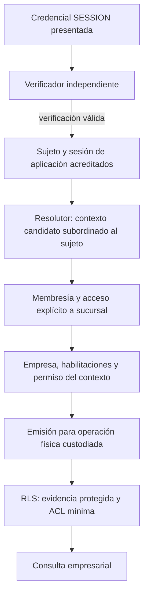
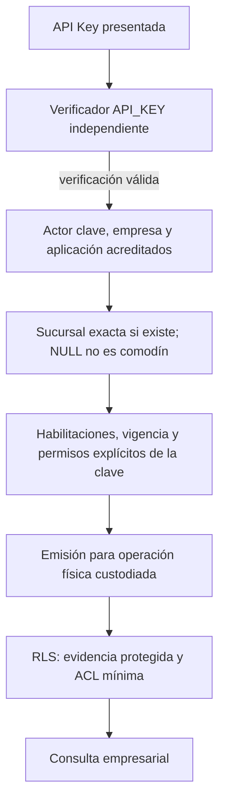

# ADR 0005 — Frontera de confianza y autorización RLS

- Fecha de registro: 2026-10-20.
- Estado: **Propuesto**. No hay aceptación de arquitectura ni autorización de implementación.
- Base inspeccionada: `origin/main`, `9c4c7a48f97d8527c822d536ce04ba47f073beed`, posterior al PR #22.
- Trazabilidad: [F03 / LFD-4](https://lssoluciones.atlassian.net/browse/LFD-4),
  [LFD-29](https://lssoluciones.atlassian.net/browse/LFD-29),
  [LFD-30](https://lssoluciones.atlassian.net/browse/LFD-30),
  [F04 / LFD-5](https://lssoluciones.atlassian.net/browse/LFD-5),
  [F05 / LFD-6](https://lssoluciones.atlassian.net/browse/LFD-6) y
  [F16 / LFD-17](https://lssoluciones.atlassian.net/browse/LFD-17).
- Alcance: propuesta documental de confianza, lectura previa y frescura; sin SQL ejecutable.
- Relación: complementa [ADR 0002](0002-postgresql-y-conectividad.md) y
  [ADR 0004, Propuesto](0004-migraciones-administrativas.md); no cambia sus estados.

## 1. Contexto y problema

V9 mantiene ENABLE/FORCE RLS en 22 tablas, sin políticas positivas. El runtime
empresarial no tiene privilegios de negocio. Esa combinación cierra acceso,
pero no permite todavía una consulta empresarial legítima.

LFD-28 entrega infraestructura de contexto, no autenticación. Un UUID, token sin
verificar o variable de sesión no demuestra identidad, pertenencia ni permiso.
La lectura de sesiones, membresías y habilitaciones necesaria para resolver el
contexto también está cerrada por RLS: usar ese contexto para obtenerse a sí mismo
produciría circularidad. Falta una raíz de confianza independiente del solicitante.

Este ADR separa lo existente, las propiedades requeridas y una construcción
candidata. Publicarlo no autoriza crear objetos, roles, grants, autenticadores,
funciones privilegiadas ni políticas; tampoco cerrar F03 o iniciar LFD-30.

## 2. Garantías actuales y faltantes

| Elemento inspeccionado | Implementado | Lo que no demuestra |
| --- | --- | --- |
| V2–V5 | 29 tablas de dominio y referencias iniciales | Autenticación, autorización o vigencia |
| V6–V7 | FK compuestas, unicidad, presencia e índices | Que una relación existente esté vigente o sea delegable |
| V8 | 28 semillas en siete catálogos globales | PUBLISHED no concede permisos empresariales |
| V9 y D1/D2 | Denegación total; FORCE sobre propietario restringido y ACL del runtime | Acceso positivo o aislamiento bajo futuras políticas |
| D3.1 | Nueve GUC reales falsificadas sin abrir acceso; 486 comprobaciones nuevas, 1317 totales registradas | Identidad auténtica, G2 o G3; no se repite esa ejecución aquí |
| TrustedContextSource | Puerto de evidencia, sin adaptador productivo | Implementar la interfaz o devolver VERIFIED no autentica |
| ContextResolver / AuthorizedContext | Validación estructural SESSION/API_KEY, expiración, constructor privado y consumo único | Verificación criptográfica ni evidencia PostgreSQL no falsificable |
| ContextTransaction | Misma transacción, set_config local, controles GUC/XID, resultados materializados, rollback/expulsión | Sandbox SQL, atomicidad con revocación o saneamiento universal de recursos retenidos |

Las nueve claves reales son `ls.tenant_id`, `ls.application_id`, `ls.branch_id`,
`ls.origin`, `ls.actor_id`, `ls.credential_id`, `ls.session_context_id`,
`ls.membership_id` y `ls.branch_membership_id`. D2 también usa los señuelos
`ls.user_id`, `ls.session_id` y `ls.is_admin`; no son claves del contrato LFD-28.
Ninguna de las doce es una autoridad por el mero hecho de estar establecida.

Contratos de roles leídos en código/documentación, no auditados en un servidor:

- `ls_core_app_dev`: LOGIN restringido, sin propiedad, privilegios empresariales,
  membresías elevadas ni BYPASSRLS. Pool empresarial read-only, máximo tres.
- `ls_core_migrator_dev`: propietario de los ocho esquemas y sus objetos;
  responsabilidad DDL administrativa, nunca identidad runtime. FORCE no le
  retira su capacidad de alterar políticas.
- C1 `ls_core_catalog_reader_dev`: NOLOGIN y lectura de columnas de siete catálogos.
  C2 `ls_core_catalog_service_dev`: LOGIN SCRAM, NOINHERIT y SET explícito a C1,
  sin ADMIN ni herencia en la membresía. Se conservan sus contratos y canal conectado.

Los siete catálogos fuera de RLS son catalog.applications, catalog.modules,
security.permissions, security.role_templates, security.role_template_permissions,
security.profile_templates y security.profile_template_roles. Las otras tablas
globales de identidad, sesiones, plataforma y operación sí están protegidas.
tenant.tenants usa id como raíz; audit.events admite tenant/application nulos y
no tiene sucursal. No se aplica un predicado tenant_id universal a las 22 tablas.

Faltan autenticación real, reglas funcionales, lectura previa mínima, evidencia
verificable por PostgreSQL, políticas positivas, ACL por operación y validación
independiente. Las afirmaciones históricas de documentación anterior sobre RLS
futura no sustituyen el estado implementado por V9.

## 3. Modelo de amenazas y responsabilidades

| Nivel | Capacidad del atacante | Garantía exigida y límite |
| --- | --- | --- |
| A — Cliente hostil | Controla HTTP, UUID, filtros, cookies, parámetros y tokens no verificados; no SQL arbitrario | Autenticar credencial y subordinar cada selector a evidencia del servidor; no inferir autorización del dato recibido |
| B — SQL hostil | Ejecuta sentencias con los privilegios del runtime empresarial; cambia ls.*, parámetros y transacciones; evita Java | La base debe denegar ampliación de ámbito y fabricación/reutilización de evidencia, aun en conexión directa |
| Fuera de esa raíz | Compromiso del autenticador/emisor, administrador PostgreSQL o host | Son autoridades críticas; requieren separación, custodia y auditoría, no una promesa de resistencia mediante RLS |

Autenticación acredita credencial y sujeto. Autorización funcional decide operación,
ámbito, vigencia y delegación. ACL limita objetos/columnas/comandos. RLS restringe
filas dentro de esos privilegios. Ninguna sustituye las otras tres.

El nivel B no implica poder leer secretos de otro proceso ni usar otra identidad
PostgreSQL. Si el runtime puede obtener la credencial del emisor, asumir su rol,
escribir evidencia o sustituir su código, la separación propuesta queda invalidada.
No se promete aislamiento de metadatos, tiempos, locks o disponibilidad universal
entre sesiones del mismo LOGIN. Los errores de FK/UNIQUE y estadísticas también
requieren revisión; proteger filas no elimina esos canales.

## 4. Alternativas comparadas

| Alternativa | Confianza y niveles A/B | Lectura previa y cambios futuros | Compatibilidad/coste | Evidencia y motivo de selección |
| --- | --- | --- | --- | --- |
| **1. SQL confiable y validación Java** | A, condicionado a autenticador real y SQL fijo parametrizado. B no: el atacante puede fabricar/restaurar GUC o evitar el ejecutor | Sigue necesitando lector confiable de evidencia y ACL/RLS positivas; no resuelve bootstrap por sí sola | Mayor compatibilidad con LFD-28 y menor coste operativo | Probar selectores y consultas internas solo acredita su perímetro. Descartada como garantía completa frente a B |
| **2. Identidades PostgreSQL delimitadas** | Identidad física autenticada y mapeo protegido a empresa/aplicación/sucursal; sin membresías que permitan otros ámbitos. B no puede cambiar esa identidad por SET ls.* | Provisionar LOGIN/pools y mapeo; separar verificación inicial. Un rol genérico con SET ROLE a todos los ámbitos vuelve a ser falsificable | Rediseña selección/reutilización física de LFD-28 y exige presupuesto agregado de conexiones; el pool empresarial actual tiene máximo tres, no un límite universal entre pools. Coste crece con ámbitos y rotación | Probar login directo, ámbitos distintos, SET ROLE, actor y revocación. Defendible para confinamiento fijo; no elegida como principal por coste y falta de identidad/frescura del actor en roles compartidos por ámbito |
| **3a. Registro protegido por operación** | Emisor separado acredita identidad/permiso; PostgreSQL busca evidencia por vínculo nativo de la operación. B no puede emitirla o cambiarla. Protección condicional a las premisas de sección 5 | Nuevos objetos técnicos, identidades limitadas, ACL/políticas de fuente y registro; coordinación de admisión y revocación. Sin SECURITY DEFINER necesario conceptualmente | Conserva claims y validaciones LFD-28, pero cambia admisión, custodia física y control de frescura; coste de lecturas/control, WAL, limpieza y conexiones adicionales presupuestadas | Exige positivos A/B no vacíos, SQL directo, antirreplay y pruebas concurrentes. Recomendada como candidata, no solución demostrada de G3 |
| **3b. Aserción autenticada verificable en PostgreSQL** | Emisor externo; integridad verificable en base. Claims no fabricables solo si el verificador, audiencia y enlace son correctos | Verificador/posible extensión, claves, rotación, antirreplay y canal de invalidación. Una firma sin revocación solo ofrece vigencia acotada | Reutiliza transporte de contexto, pero no existe verificador aprobado. Coste criptográfico y operacional nuevo | Probar firma, claves rotadas, replay, snapshot y revocación. No elegida ahora: añade dependencia criptográfica sin resolver automáticamente frescura |

Separar roles por responsabilidad es necesario en 2 y 3, pero no aísla por sí
solo tenants que comparten un LOGIN con capacidad equivalente. NOINHERIT no
elimina una membresía SET; NOLOGIN tampoco impide asumir el rol si está permitido.
El mapeo de identidad no puede depender de un nombre de rol interpretado libremente.
[Membresías PG17](https://www.postgresql.org/docs/17/role-membership.html).
En la alternativa 2, la referencia es el LOGIN original de la conexión
(`session_user`), con mapeo protegido; no `current_user` libremente conmutable
mediante membresías SET. También deben excluirse vías de cambio de identidad.

## 5. Recomendación técnica y condiciones de viabilidad

Proponer **3a, evidencia protegida por operación, con verificador inicial y
resolutor separados del runtime**. Es una recomendación de diseño, no aceptación
del protocolo histórico B2/B2-R ni autorización para reabrir sus experimentos.

La construcción candidata requiere aprobar y demostrar estas propiedades:

1. El autenticador verifica la credencial real. El resolutor lee evidencia
   coherente, aplica reglas aprobadas y emite una decisión específica de operación.
   Ningún VERIFIED fijo o UUID aportado por el cliente satisface este paso.
2. Un coordinador posee la conexión física destinada a la operación. El emisor
   acepta un vínculo obtenido por ese canal confiable, nunca PID/XID declarados
   por el solicitante. El vínculo incluye identidad de instancia/base, LOGIN
   físico, backend e inicio, y transacción de ancho completo; esos identificadores
   vinculan, pero no autentican al usuario. La forma exacta requiere revisión.
3. El registro conserva origen, actor, credencial, empresa/aplicación/sucursal,
   vínculos SESSION, recurso/comando, dependencias de autorización y vencimiento.
   Sus claims son únicos e inmutables para ese vínculo; su vigencia se controla
   explícitamente. No contiene secretos ni verificadores.
4. El emisor solo puede publicar/inactivar evidencia por el protocolo aprobado.
   El runtime no puede escribirla, asumir al emisor, crear objetos sustitutos ni
   escoger una autorización ajena mediante GUC. Sin entrada auténtica, denegación.
5. La política del registro consulta solo identidad nativa y datos de control
   permitidos; no se consulta a sí misma ni a tablas empresariales. Las políticas
   empresariales dependen de ese registro, no de un grafo recursivo de membresías.
6. Las nueve GUC son selectores contrastables con evidencia, nunca su fuente.
   Actor/origen/ámbito no cambian en una operación. Cambiar transacción o conexión
   invalida el vínculo; iniciar otra exige nueva admisión.
7. El perfil inicial candidato requiere READ COMMITTED y rechazo de snapshots
   incompatibles dentro de la frontera de base, no solo un default Java/rol.
   SQL hostil no puede convertir un cambio de aislamiento en autorización.
   La evidencia se reevalúa por sentencia; no se congela en planes o funciones
   declaradas inmutables. Esto necesita prueba, no se deduce de la configuración.
8. Todos los escritores de sesión/membresía/habilitación/permiso participan en
   invalidación y admisión serializadas. Proponer fuente y control en la misma
   base y transacción de cambio cuando sea viable; no asumir atomicidad entre
   conexiones o sistemas distintos. Una fuente externa exige otro protocolo
   aprobado; sin él, no hay garantía de próxima operación.
9. El cierre de operaciones concurrentes y recursos retenidos necesita un
   mecanismo independiente de las GUC y del snapshot del atacante. No se confirma
   revocación fuerte mientras falte verificar ese cierre; TTL o COMMIT no bastan.

El registro sería adicional a las 29 tablas de dominio. Su ubicación, ownership,
retención, índices, roles y nueva migración administrativa requieren aprobación
separada. No se modifica V1–V9 ni se ofrece aquí DDL o una política positiva.

Las identidades de verificación/resolución/control son parte de la raíz de confianza:
credenciales separadas, ninguna membresía desde runtime y permisos por columnas,
sin propiedad ni BYPASSRLS. El migrador tampoco es su identidad de servicio.
La lectura previa se describe en sección 6; no queda resuelta por dar SELECT al ER.

**Con las restricciones y componentes actuales no se puede garantizar acceso
legítimo para ambos niveles A/B.** La postura ejecutable sigue siendo denegación.
Incluso implementando un registro, G3 quedaría bloqueada sin el protocolo de
frescura/cierre aprobado y demostrado. Si no se acepta esa coordinación, reevaluar
la alternativa 2 con su coste explícito; no degradar silenciosamente a alternativa 1.

## 6. Lectura previa sin circularidad

Las responsabilidades siguientes son conceptuales; no son roles creados:
C designa el contexto empresarial autorizado que todavía se intenta resolver.

- **V:** verificador de credencial, con identidad PostgreSQL propia e inaccesible a ER.
- **R:** resolutor de autorización, sin acceso a verificadores.
- **E:** emisor/control de evidencia, sin SELECT de negocio ni credenciales de V.
- **ER:** ejecutor empresarial; solo evidencia de su operación y columnas autorizadas.

### 6.1 Raíz del acceso previo

V necesita encontrar un candidato antes de autenticar. Su capacidad de lectura
se funda en su identidad de servicio autenticada por PostgreSQL y una futura
política de bootstrap explícita para esa responsabilidad, independiente de C y
ls.*. Solo columnas de verificación y SQL fijo de búsqueda; identificar un candidato
no autentica al solicitante. Comparación del verificador, expiración/bloqueo y
errores públicos genéricos preceden a cualquier emisión.

R necesita campos de autorización entre ámbitos para comprobar el objetivo
derivado de una identidad ya autenticada. Su acceso previo también requiere
capacidad explícita de servicio, no una política dependiente del contexto que
intenta resolver. Aunque acotada por columnas y propósito, esta es una capacidad
sensible sobre varios sujetos y debe aprobarse como tal; no se presenta como
aislamiento frente al compromiso de V/R. No admitir SQL de cliente en esos canales.

Las políticas/ACL de bootstrap serían nuevas y expresamente revisadas por rol,
tabla y columna. El runtime no las hereda ni puede asumirlas. No se propone ALL
TABLES, propiedad, BYPASSRLS, SECURITY DEFINER ni vistas de propietario como atajo.
Hasta autorizar esos accesos, el adaptador no puede consultar la evidencia real.

### 6.2 Grafos conceptuales

El login inicial con contraseña requiere V de credenciales de F04 y emisión de
sesión de F05; una petición posterior verifica la credencial de sesión, no vuelve
a convertir username ni session_id recibido en identidad. El selector de empresas
previo al contexto solo podrá devolver opciones derivadas de la identidad verificada
y sus vínculos, por vía específica de R; no listado global a ER.

API_KEY no obtiene membresía/contexto de usuario ni atribuye el creador como actor.
Un ámbito tenant sin sucursal necesita operaciones tenant explícitas; no autoriza
consultas de cualquier sucursal. La petición solo puede restringir el resultado.

### 6.3 Tablas e insumos mínimos candidatos

V/R designan los canales anteriores y sus futuras ACL/políticas independientes
del contexto empresarial. Ninguna fila de esta tabla es un grant aprobado. No se
necesitan nombres, correos o campos descriptivos para resolver permisos salvo el
identificador de búsqueda que apruebe el protocolo de autenticación.

| Tabla | Consumidor y columnas estrictamente necesarias por finalidad | Fundamento y límite de acceso previo |
| --- | --- | --- |
| identity.users | V/R: id,status. V añade username si ese es el identificador aprobado; email/email_verified_at solo si se aprueba esa vía | Identidad V/R; búsqueda candidata no autoriza. display_name no es evidencia |
| identity.user_credentials | V de contraseña: user_id,password_hash,password_expires_at,locked_until,must_change_password; failed_attempts solo para política de bloqueo aprobada | Bootstrap exclusivo V; verificador nunca a R/E/ER, navegador o logs. Escrituras de contadores/ciclo fuera de este contrato lector |
| security.sessions | V: id,user_id,application_id,token_hash,expires_at,revoked_at. R recibe los mismos metadatos sin token_hash | V verifica token; R recibe prueba ligada a la sesión, no session_id libre. No tenant_id ficticio |
| security.session_contexts | R: id,session_id,user_id,application_id,tenant_id,membership_id,branch_id,expires_at,revoked_at | Se contrasta con sesión/sujeto acreditados antes de emitir; no se autoautoriza por leer su id |
| tenant.tenants | R: id,status | Raíz por id. No requiere ni tiene tenant_id |
| tenant.memberships | R: id,tenant_id,user_id,status; accepted_at solo si la regla de vigencia lo exige | Pertenencia al sujeto acreditado; estados funcionales pendientes no se inventan |
| tenant.branches | R: id,tenant_id,status | Sucursal pertenece al tenant y cumple la política aprobada |
| tenant.branch_memberships | R: id,tenant_id,membership_id,branch_id,status | SESSION exige vínculo explícito. No se usa para fabricar membresía API_KEY |
| catalog.tenant_applications | R: tenant_id,application_id,status | Habilitación empresarial; existe antes de emitir, no se consulta recursivamente desde su propia autorización |
| catalog.tenant_modules | R: tenant_id,application_id,module_id,status | Solo módulos relevantes a la operación; publicación no sustituye habilitación |
| catalog.applications | R: id,status | Lectura global mínima por canal autorizado separado; no modificar C1/C2 ni deducir acceso de PUBLISHED |
| catalog.modules | R: id,application_id,status | Coherencia de aplicación y módulo; tampoco concede acceso |
| security.branch_profile_assignments | R: id,tenant_id,application_id,branch_membership_id,profile_id,status,revoked_at | Solo perfiles del vínculo a sucursal actual; no sumar asignaciones A2 en A1 |
| security.profiles | R: id,tenant_id,application_id,status | Perfil empresarial propio; no herencia silenciosa de plantilla |
| security.profile_roles | R: tenant_id,application_id,profile_id,role_id | Composición coherente con el perfil autorizado |
| security.roles | R: id,tenant_id,application_id,status | Rol funcional, no rol PostgreSQL; estado y vigencia según F10 |
| security.role_permissions | R: tenant_id,application_id,role_id,permission_id | Permisos derivados de roles del contexto actual |
| security.permissions | R: id,application_id,module_id,code,resource_scope,status | Definición de permiso; falta evaluador funcional/delegación aprobado |
| integration.api_keys | V: id,tenant_id,application_id,branch_id,key_hash,expires_at,revoked_at. R sin key_hash | Bootstrap F16 exclusivo V; actor es id de clave, no created_by_user_id |
| integration.api_key_permissions | R: tenant_id,application_id,api_key_id,permission_id | Solo de clave acreditada y scope compatible; sin autorización por FK únicamente |
| tenant.administrators | Sin lectura en el flujo ordinario. Si se aprueba una vía especial: R administrativo con id,tenant_id,membership_id,status,revoked_at | Designación no equivale a bypass ni permite autoemisión |
| platform.administrators | Sin lectura ordinaria. Vía global futura: id,user_id,administrator_kind,status,revoked_at | Autoridad global separada, operación objetivo y auditoría; no OR administrativo universal |
| security.role_templates, security.role_template_permissions, security.profile_templates, security.profile_template_roles | Ninguna columna para autenticar/resolver el contexto ordinario | Plantillas globales no son concesiones activas; C1/C2 intactos |
| audit.events | Ninguna lectura para establecer identidad o autorización | Eventos históricos no son fuente de autenticación; sin FK de actor, tenant/app nulos no son comodines y no existe branch_id |
| operations.maintenance_windows, operations.operation_runs | Ninguna lectura en esos grafos | Operación global no habilita datos empresariales |

El historial Flyway tampoco participa. Un registro técnico futuro expondría a ER
solo columnas necesarias de su propia entrada mediante vínculo nativo; jamás
verificadores. Las políticas empresariales no vuelven desde ese registro a V/R.
Una consulta auxiliar conserva las exigencias de privilegios del invocador;
sin ACL mínima aprobada debe fallar, no saltarse la protección.

## 7. Contrato propuesto de frescura y revocación

Definiciones candidatas: una **operación** es una admisión de trabajo delimitado,
con contexto inmutable y recursos físicos identificados; no una conexión abierta
indefinidamente. Una consulta posterior dentro de ella tampoco puede ampliar el
contexto. Se distinguen solicitud, cambio persistido, bloqueo de nuevas admisiones,
invalidación de evidencia y cierre confirmado. Los nombres no crean estados de DB.

| Evento | Nueva admisión / consulta posterior | Trabajo ya iniciado y decisión pendiente |
| --- | --- | --- |
| Sesión expirada o revocada | Denegar; contexto sin vencimiento propio nunca amplía sesión | Definir límite y destino del trabajo en curso; comprobación Java posterior no deshace una lectura |
| API Key expirada o revocada | Denegar como clave; no convertirla en SESSION | Misma separación; no reutilizar credencial ni renovar implícitamente evidencia |
| Membresía suspendida | Invalidar operaciones dependientes de ese vínculo, según regla aprobada | No bloquear otros tenants del mismo usuario; falta vocabulario/transición completa |
| Acceso a sucursal retirado | Denegar ese vínculo/sucursal, aunque siga existiendo membresía tenant | Otras sucursales solo con nueva autorización independiente |
| Empresa suspendida o aplicación deshabilitada | Escrituras bloqueadas; lecturas de estados restringidos requieren política explícita, sin permiso implícito | Diferenciar estado global de catálogo, habilitación tenant/aplicación y módulo; READ_ONLY no permite escritura |
| Permiso retirado | Invalidar evidencia de operaciones que lo usan, no solo una sesión | Recalcular por dependencias, sin congelar permisos en la sesión |
| Cambio de contexto entre consultas | Rechazar dentro de la operación; finalizarla y resolver/admitir una nueva | Reutilización física no transfiere evidencia ni recursos del ámbito anterior |
| Revocación concurrente | Serializar publicación/admisión frente a invalidación; ninguna nueva admisión tras su punto efectivo aprobado | Una operación admitida antes no se declara retroactivamente inexistente. Definir finalización acotada o cancelación y cierre verificable |
| Fuente o control indisponibles | No emitir nuevas autorizaciones ni usar caché positiva como fuente fresca | Evidencia ya visible puede sobrevivir a la caída del emisor: hace falta detección/retiro independiente o registrar garantía incumplida; TTL solo no prueba cierre |

Proponer que el cambio autoritativo y la invalidación de sus dependencias tengan
un único orden de confirmación. Si se reparten en commits o sistemas diferentes,
el intervalo de propagación es un bloqueo hasta diseñarlo y aprobarlo. Timestamps
updated_at existentes no constituyen por sí solos una versión de autorización.

READ COMMITTED permite observar nuevos commits en sentencias posteriores, no
alterar el snapshot de una sentencia ya iniciada. REPEATABLE READ/SERIALIZABLE
pueden mantener evidencia anterior; no son una solución automática de revocación.
[Aislamiento PG17](https://www.postgresql.org/docs/17/transaction-iso.html).
Evaluar expiración con tiempo confiable del servidor por sentencia, no únicamente
un tiempo fijo de inicio de transacción o suministrado por el cliente. Relojes,
duración máxima, política al vencer y tolerancias requieren aprobación.

No se promete revocación instantánea. La garantía fuerte de no recuperar datos
después de confirmar revocación exige inventariar y cerrar recursos controlados,
incluidos resultados retenidos, portales y salida pendiente. Commit/rollback,
cancelación solicitada o cierre del proxy Hikari no certifican por sí solos ese
resultado. Datos ya recibidos por un cliente no pueden retirarse retroactivamente.
Si el cierre no se verifica, el resultado es incierto/fallo, nunca éxito.
No se fija aquí SLA ni se adopta un plazo experimental histórico.

## 8. Dependencias Jira: F03 → F04 → F05

Requisitos consultados en Jira en lectura, 2026-10-20:

| Issue | Criterio relevante | Consecuencia para esta propuesta |
| --- | --- | --- |
| LFD-4 / F03, En curso | Contexto validado en backend y aplicado por transacción; lectura/escritura cruzada denegada, integración RLS y pool sin residuos | El cierre requiere evidencia útil de aislamiento, no solo indisponibilidad de todas las filas |
| LFD-29, En curso | Políticas SELECT/INSERT/UPDATE/DELETE, roles sin bypass, ownership y acceso global explícito | D1/D2/D3.1 no implementan aún el acceso legítimo de esas políticas |
| LFD-30, Backlog | Intentos UUID cruzados, SQL directo y reutilización del pool | Alternativa 1 no puede sustituir la frontera exigida frente al nivel B |
| LFD-5 / F04, Backlog | Precondición F03; identidad global y ciclo real de credenciales | Parte de la raíz de confianza se ha planificado después del consumidor |
| LFD-6 / F05, Backlog | Precondición F04; sesión por aplicación y suspensión/revocación efectivas en operaciones siguientes | Provee autenticación/selección/frescura necesarias para la integración completa |
| LFD-17 / F16, Backlog | Precondición F15 y fases anteriores; claves hash, scopes, expiración/revocación | API_KEY tampoco dispone de autenticador real anticipado |

LFD-35 exige selector sin confiar en IDs del cliente; LFD-36 explicita revocación
en la próxima operación. LFD-67/68 separan ciclo de claves y scopes/aislamiento.
F10 sigue siendo dependencia funcional para composición y delegación de permisos.
Los comentarios históricos no se reinterpretan como aprobación de este ADR.

**Opción 1 — Cierre técnico con fixtures:** puede producir un entregable de motor
valioso y reproducible, con identidades sintéticas y límites explícitos. Los textos
actuales no dicen que F03 deba implementar login HTTP completo, pero tampoco
autorizan llamar contexto validado a UUID/GUC libres o ignorar SQL directo.
Una futura evidencia positiva completa con fixtures y raíz de confianza controlada
podría acreditar un contrato técnico acotado; no acredita autenticación/vigencia
real. Cerrar F03 integral sobre esa base exige que el propietario delimite
explícitamente su aceptación y ubicación de las garantías restantes. Hoy no hay
esa decisión ni políticas positivas: **opción 1 no basta para declarar satisfechos
los criterios actuales completos de LFD-4/LFD-29**. No rebajarlos por interpretación.

**Opción 2 — Descomponer la dependencia:** recomendada para conservar los criterios.
Proponer un hito F03 técnico, sin cierre de la historia, que contenga infraestructura,
denegación y el contrato aprobado. Extraer una capacidad mínima de autenticación
y lectura autoritativa de F04/F05 como prerrequisito del cierre integral F03;
mantener login/UI, cookies, recuperación y el resto de F04/F05 en su fase propia.
Esa capacidad mínima debe depender de F02 y del hito técnico, no de F03 completa.
Su consumo exige después las políticas y pruebas de aislamiento aprobadas.

Es necesario aprobar la excepción de orden para evitar recrear el ciclo. Para
API_KEY, conservar denegación hasta F16 o descomponer su capacidad mínima con la
misma revisión; no adelantar toda F16 ni declarar el origen soportado por fixtures.
El cierre final de F03 debe indicar expresamente qué origen cubre y dónde se
acepta cada integración restante, sin retirar requisitos silenciosamente.
No se inventan nuevos IDs ni se cambian enlaces, textos o estados Jira aquí.

## 9. Decisiones y riesgos que requieren aprobación

| Decisión | Condición de revisión / detención |
| --- | --- |
| Elegir alternativa 3a y raíz de confianza | Contrato de emisor, verificador y custodia; sin aprobación, ninguna concesión empresarial |
| Acceso de bootstrap V/R | Matriz exacta de identidades, tablas/columnas, políticas y custodia de secretos; reconocer alcance entre sujetos y riesgo de compromiso |
| Registro y vínculo | Ubicación, ownership, unicidad, antirreplay, lectura propia y verificación de aislamiento; sin PID/XID del solicitante |
| Frescura y concurrencia | Punto efectivo, todos los escritores invalidantes, snapshots permitidos, fallo de fuente y cierre; no aprobación implícita de barrera histórica |
| Reglas funcionales | Estados/transiciones, permisos/delegación, lecturas suspendidas y API_KEY sin sucursal; desconocidos no conceden acceso |
| Roles/ACL y operación | Sin membresías elevadas; conexiones adicionales presupuestadas fuera del pool de tres para evitar esperas circulares; sin ampliar C1/C2 |
| Vías especiales | Plataforma, auditoría y operación separadas; sin OR global, hashes expuestos o privilegios empresariales por mantenimiento |
| Planificación | Hito técnico y capacidad mínima previa; aceptación explícita por origen y criterios pendientes sin cerrar F03/LFD-29 |
| Evidencia independiente | Positivos A/B no vacíos, SQL hostil y pool; frescura/revocación por separado, con autorización futura de alcance y fallos |

La complejidad y el coste del control por operación son consecuencias reales de
la recomendación. Si no se aceptan, debe revisarse la arquitectura o el requisito
de amenaza mediante decisión expresa; no presentar más validaciones Java como
una garantía equivalente. Ninguna prueba aislada certifica producción.

## 10. Primer incremento implementable después de aprobar el ADR

Proponer **contratos inactivos de admisión y evidencia**, separados de los records
de entrada de TrustedContextSource. No conectar todavía un adaptador productivo,
abrir RLS ni aceptar una evidencia proporcionada por HTTP.

Archivos probables, sujetos a revisión del incremento:

- Nuevos contratos bajo `backend/src/main/java/com/lssoluciones/lscore/access/application/context/`
  para admisión, vínculo de operación y decisión de evidencia, con fallo por defecto.
- Prueba focalizada bajo el directorio de tests correspondiente.
- Documento breve de contrato y actualización de referencias necesaria.

Prueba mínima futura: rechazar emisor ausente, evidencia desconocida/expirada,
ámbito u origen incoherentes y reutilización del vínculo; preservar SESSION y
API_KEY separados. Un doble sintético solo valida el contrato, no autenticación,
integridad de evidencia en PostgreSQL ni G2/G3. Constructor privado no es esa prueba.

Aceptación: sin evidencia confiable no hay admisión; no se registra bean/adaptador,
no se modifica el ejecutor de solo lectura ni se concede permiso. El contrato debe
indicar cómo el futuro mecanismo acredita la vinculación, sin confiar en Claims
libres ni sustituir AuthorizedContext. Detenerse si faltan decisiones de vínculo,
reglas o autenticación: no rellenar VERIFIED para continuar.

Después se requerirán incrementos separados para bootstrap real, registro/ACL,
una primera lectura positiva y validación independiente. Cada SQL, rol, migración
nueva o cambio Java operativo exige su autorización específica. Aprobar este ADR
no autoriza esos incrementos ni reanuda B2-R/R07/R01–R38 o G2/G3.

## Fuentes y evidencia de esta entrega documental

Inspección de [contexto LFD-28](../multi-tenant-context.md),
[diccionario](../database/data-dictionary.md), [D2](../verification-lfd-29-d2.md),
[D3.1](../verification-lfd-29-d3.md), ADR 0002/0004, clases de contexto y V2–V9.
Los scripts de provisión/C1/C2 se leyeron, no ejecutaron. Los tres diseños locales
protegidos se consultaron como antecedentes propuestos; no son una aprobación
ni un artefacto requerido del repositorio publicado.

Referencias de código: [TrustedContextSource](../../backend/src/main/java/com/lssoluciones/lscore/access/application/context/TrustedContextSource.java),
[ContextResolver y AuthorizedContext](../../backend/src/main/java/com/lssoluciones/lscore/access/application/context/ContextResolver.java),
[ContextTransaction](../../backend/src/main/java/com/lssoluciones/lscore/operations/infrastructure/jdbc/ContextTransaction.java).

Semántica técnica contrastada con PostgreSQL 17:
[RLS y límites](https://www.postgresql.org/docs/17/ddl-rowsecurity.html),
[políticas por comando](https://www.postgresql.org/docs/17/sql-createpolicy.html),
[identidad de sesión/transacción](https://www.postgresql.org/docs/17/functions-info.html).
RLS añade filtros a ACL; USING trata filas existentes y WITH CHECK nuevas.
FORCE no elimina autoridad DDL ni bypass administrativo. Las políticas y consultas
auxiliares deben revisarse por invocador y composición, sin depender de GUC libres.

En esta entrega no se ejecutan pruebas manuales ni conexiones PostgreSQL. El CI
estándar que dispare el push solo verifica la base publicada con sus suites
existentes; su éxito no valida la arquitectura propuesta. LFD-29 permanece En
curso, LFD-30 Backlog y F03 sin declaración de cierre.
