# Diccionario físico PostgreSQL 17 — LFD-25

Modelo aprobado en [comentario 10044](https://lssoluciones.atlassian.net/browse/LFD-25?focusedCommentId=10044), 2026-10-16. Tablas implementadas en V2–V5 e integridad reforzada en V6–V7: **29 tablas vacías de dominio**, ocho esquemas. `operations.flyway_schema_history` es adicional y exclusivo de Flyway. No se ejecutó sobre PostgreSQL real.

## Convenciones y límites

E: UUID nativo `gen_random_uuid()`, created_at/updated_at. M: PK explícita y ambos timestamps. C: PK compuesta y created_at. A: UUID y created_at, sin updated_at. Todos los timestamps son TIMESTAMPTZ; CURRENT_TIMESTAMP es un default técnico de creación, también inicializa updated_at. **El escritor futuro debe actualizar updated_at**: no hay triggers. No existen defaults de estados, ENUM, semillas ni deleted_at universal.

Las referencias simples se originaron en V2–V5; diez fueron reemplazadas por FK compuestas en V6, indicadas por la matriz de integridad más abajo. Las restantes se conservan con NO ACTION, sin cascadas. V6 exige pertenencia compuesta empresarial y de aplicación. En auditoría se conservan identificadores sin FK para no condicionar la conservación histórica a la existencia de la entidad. La representación de verificadores no implementa hashing ni impide por sí sola que un escritor indebido guarde un secreto; esos controles son futuros.

Solo tienen CHECK de vocabulario: tenants.status PENDING/ACTIVE/SUSPENDED; tenant_applications.status y tenant_modules.status ACTIVE/READ_ONLY/DISABLED; administrators.administrator_kind OWNER/SUPERADMIN. users exige username o email informado; V7 rechaza blanco y aplica unicidad normalizada de username/correo verificado según la política descrita más abajo. Otros estados, resource_scope, actor_kind, outcome y operation_type siguen TEXT: vocabularios y transiciones funcionales pendientes. No se deduce una transición por enumerar estados.

Catálogo global de permisos y plantillas versionadas administrado por LS Soluciones. Roles y perfiles empresariales son copias propias editables con referencia opcional al origen, sin herencia silenciosa. Varias asignaciones de perfiles por branch_membership son posibles; los perfiles de otras sucursales no deben agregarse al contexto actual. No hay cálculo de permisos ni concesión funcional por insertar una designación.

## identity.users

Identidades globales, sin credencial obligatoria.

PK: `(id)`. Patrón **E**.

| Columna | Tipo PostgreSQL | Nulo | Default técnico |
| --- | --- | --- | --- |
| `id` | `UUID` | No | `gen_random_uuid()` |
| `username` | `TEXT` | Sí | — |
| `email` | `TEXT` | Sí | — |
| `email_verified_at` | `TIMESTAMPTZ` | Sí | — |
| `display_name` | `TEXT` | No | — |
| `status` | `TEXT` | No | — |
| `created_at` | `TIMESTAMPTZ` | No | `CURRENT_TIMESTAMP` |
| `updated_at` | `TIMESTAMPTZ` | No | `CURRENT_TIMESTAMP` |

Referencias implementadas tras V7: ninguna.

## identity.user_credentials

Verificador de contraseña de una identidad.

PK: `(user_id)`. Patrón **M**.

| Columna | Tipo PostgreSQL | Nulo | Default técnico |
| --- | --- | --- | --- |
| `user_id` | `UUID` | No | — |
| `password_hash` | `TEXT` | No | — |
| `must_change_password` | `BOOLEAN` | No | — |
| `password_changed_at` | `TIMESTAMPTZ` | No | — |
| `password_expires_at` | `TIMESTAMPTZ` | No | — |
| `failed_attempts` | `INTEGER` | No | — |
| `locked_until` | `TIMESTAMPTZ` | Sí | — |
| `created_at` | `TIMESTAMPTZ` | No | `CURRENT_TIMESTAMP` |
| `updated_at` | `TIMESTAMPTZ` | No | `CURRENT_TIMESTAMP` |

Referencias implementadas tras V7: `user_id → identity.users.id`.

## platform.administrators

Designación global OWNER o SUPERADMIN, independiente del tenant.

PK: `(id)`. Patrón **E**.

| Columna | Tipo PostgreSQL | Nulo | Default técnico |
| --- | --- | --- | --- |
| `id` | `UUID` | No | `gen_random_uuid()` |
| `user_id` | `UUID` | No | — |
| `administrator_kind` | `TEXT` | No | — |
| `status` | `TEXT` | No | — |
| `granted_by_user_id` | `UUID` | Sí | — |
| `revoked_by_user_id` | `UUID` | Sí | — |
| `revoked_at` | `TIMESTAMPTZ` | Sí | — |
| `created_at` | `TIMESTAMPTZ` | No | `CURRENT_TIMESTAMP` |
| `updated_at` | `TIMESTAMPTZ` | No | `CURRENT_TIMESTAMP` |

Referencias implementadas tras V7: `user_id → identity.users.id`; `granted_by_user_id → identity.users.id`; `revoked_by_user_id → identity.users.id`.

## catalog.applications

Aplicaciones del catálogo global.

PK: `(id)`. Patrón **E**.

| Columna | Tipo PostgreSQL | Nulo | Default técnico |
| --- | --- | --- | --- |
| `id` | `UUID` | No | `gen_random_uuid()` |
| `code` | `TEXT` | No | — |
| `name` | `TEXT` | No | — |
| `description` | `TEXT` | Sí | — |
| `status` | `TEXT` | No | — |
| `created_at` | `TIMESTAMPTZ` | No | `CURRENT_TIMESTAMP` |
| `updated_at` | `TIMESTAMPTZ` | No | `CURRENT_TIMESTAMP` |

Referencias implementadas tras V7: ninguna.

## catalog.modules

Módulos del catálogo global.

PK: `(id)`. Patrón **E**.

| Columna | Tipo PostgreSQL | Nulo | Default técnico |
| --- | --- | --- | --- |
| `id` | `UUID` | No | `gen_random_uuid()` |
| `application_id` | `UUID` | No | — |
| `code` | `TEXT` | No | — |
| `name` | `TEXT` | No | — |
| `description` | `TEXT` | Sí | — |
| `status` | `TEXT` | No | — |
| `created_at` | `TIMESTAMPTZ` | No | `CURRENT_TIMESTAMP` |
| `updated_at` | `TIMESTAMPTZ` | No | `CURRENT_TIMESTAMP` |

Referencias implementadas tras V7: `application_id → catalog.applications.id`.

## security.permissions

Permisos globales administrados por LS Soluciones.

PK: `(id)`. Patrón **E**.

| Columna | Tipo PostgreSQL | Nulo | Default técnico |
| --- | --- | --- | --- |
| `id` | `UUID` | No | `gen_random_uuid()` |
| `application_id` | `UUID` | No | — |
| `module_id` | `UUID` | Sí | — |
| `code` | `TEXT` | No | — |
| `name` | `TEXT` | No | — |
| `description` | `TEXT` | Sí | — |
| `resource_scope` | `TEXT` | No | — |
| `status` | `TEXT` | No | — |
| `created_at` | `TIMESTAMPTZ` | No | `CURRENT_TIMESTAMP` |
| `updated_at` | `TIMESTAMPTZ` | No | `CURRENT_TIMESTAMP` |

Referencias implementadas tras V7: `application_id → catalog.applications.id`; `(application_id,module_id) → catalog.modules(application_id,id)`.

## security.role_templates

Plantillas versionadas de roles globales.

PK: `(id)`. Patrón **E**.

| Columna | Tipo PostgreSQL | Nulo | Default técnico |
| --- | --- | --- | --- |
| `id` | `UUID` | No | `gen_random_uuid()` |
| `application_id` | `UUID` | No | — |
| `code` | `TEXT` | No | — |
| `version` | `INTEGER` | No | — |
| `name` | `TEXT` | No | — |
| `description` | `TEXT` | Sí | — |
| `status` | `TEXT` | No | — |
| `created_at` | `TIMESTAMPTZ` | No | `CURRENT_TIMESTAMP` |
| `updated_at` | `TIMESTAMPTZ` | No | `CURRENT_TIMESTAMP` |

Referencias implementadas tras V7: `application_id → catalog.applications.id`.

## security.role_template_permissions

Composición de permisos de una plantilla de rol.

PK: `(role_template_id, permission_id)`. Patrón **C**.

| Columna | Tipo PostgreSQL | Nulo | Default técnico |
| --- | --- | --- | --- |
| `application_id` | `UUID` | No | — |
| `role_template_id` | `UUID` | No | — |
| `permission_id` | `UUID` | No | — |
| `created_at` | `TIMESTAMPTZ` | No | `CURRENT_TIMESTAMP` |

Referencias implementadas tras V7: `application_id → catalog.applications.id`; `(application_id,role_template_id) → security.role_templates(application_id,id)`; `(application_id,permission_id) → security.permissions(application_id,id)`.

## security.profile_templates

Plantillas versionadas de perfiles globales.

PK: `(id)`. Patrón **E**.

| Columna | Tipo PostgreSQL | Nulo | Default técnico |
| --- | --- | --- | --- |
| `id` | `UUID` | No | `gen_random_uuid()` |
| `application_id` | `UUID` | No | — |
| `code` | `TEXT` | No | — |
| `version` | `INTEGER` | No | — |
| `name` | `TEXT` | No | — |
| `description` | `TEXT` | Sí | — |
| `status` | `TEXT` | No | — |
| `created_at` | `TIMESTAMPTZ` | No | `CURRENT_TIMESTAMP` |
| `updated_at` | `TIMESTAMPTZ` | No | `CURRENT_TIMESTAMP` |

Referencias implementadas tras V7: `application_id → catalog.applications.id`.

## security.profile_template_roles

Composición de roles de una plantilla de perfil.

PK: `(profile_template_id, role_template_id)`. Patrón **C**.

| Columna | Tipo PostgreSQL | Nulo | Default técnico |
| --- | --- | --- | --- |
| `application_id` | `UUID` | No | — |
| `profile_template_id` | `UUID` | No | — |
| `role_template_id` | `UUID` | No | — |
| `created_at` | `TIMESTAMPTZ` | No | `CURRENT_TIMESTAMP` |

Referencias implementadas tras V7: `application_id → catalog.applications.id`; `(application_id,profile_template_id) → security.profile_templates(application_id,id)`; `(application_id,role_template_id) → security.role_templates(application_id,id)`.

## tenant.tenants

Empresas y su estado aprobado.

PK: `(id)`. Patrón **E**.

| Columna | Tipo PostgreSQL | Nulo | Default técnico |
| --- | --- | --- | --- |
| `id` | `UUID` | No | `gen_random_uuid()` |
| `name` | `TEXT` | No | — |
| `status` | `TEXT` | No | — |
| `created_at` | `TIMESTAMPTZ` | No | `CURRENT_TIMESTAMP` |
| `updated_at` | `TIMESTAMPTZ` | No | `CURRENT_TIMESTAMP` |

Referencias implementadas tras V7: ninguna.

## tenant.branches

Sucursales de una empresa.

PK: `(id)`. Patrón **E**.

| Columna | Tipo PostgreSQL | Nulo | Default técnico |
| --- | --- | --- | --- |
| `id` | `UUID` | No | `gen_random_uuid()` |
| `tenant_id` | `UUID` | No | — |
| `code` | `TEXT` | No | — |
| `name` | `TEXT` | No | — |
| `status` | `TEXT` | No | — |
| `created_at` | `TIMESTAMPTZ` | No | `CURRENT_TIMESTAMP` |
| `updated_at` | `TIMESTAMPTZ` | No | `CURRENT_TIMESTAMP` |

Referencias implementadas tras V7: `tenant_id → tenant.tenants.id`.

## tenant.memberships

Vinculación de identidad con empresa.

PK: `(id)`. Patrón **E**.

| Columna | Tipo PostgreSQL | Nulo | Default técnico |
| --- | --- | --- | --- |
| `id` | `UUID` | No | `gen_random_uuid()` |
| `tenant_id` | `UUID` | No | — |
| `user_id` | `UUID` | No | — |
| `status` | `TEXT` | No | — |
| `invited_by_user_id` | `UUID` | Sí | — |
| `accepted_at` | `TIMESTAMPTZ` | Sí | — |
| `created_at` | `TIMESTAMPTZ` | No | `CURRENT_TIMESTAMP` |
| `updated_at` | `TIMESTAMPTZ` | No | `CURRENT_TIMESTAMP` |

Referencias implementadas tras V7: `tenant_id → tenant.tenants.id`; `user_id → identity.users.id`; `invited_by_user_id → identity.users.id`.

## tenant.branch_memberships

Acceso de una membresía a una sucursal.

PK: `(id)`. Patrón **E**.

| Columna | Tipo PostgreSQL | Nulo | Default técnico |
| --- | --- | --- | --- |
| `id` | `UUID` | No | `gen_random_uuid()` |
| `tenant_id` | `UUID` | No | — |
| `membership_id` | `UUID` | No | — |
| `branch_id` | `UUID` | No | — |
| `status` | `TEXT` | No | — |
| `created_at` | `TIMESTAMPTZ` | No | `CURRENT_TIMESTAMP` |
| `updated_at` | `TIMESTAMPTZ` | No | `CURRENT_TIMESTAMP` |

Referencias implementadas tras V7: `tenant_id → tenant.tenants.id`; `(tenant_id,membership_id) → tenant.memberships(tenant_id,id)`; `(tenant_id,branch_id) → tenant.branches(tenant_id,id)`.

## tenant.administrators

Designación explícita de administrador empresarial, independiente de perfiles.

PK: `(id)`. Patrón **E**.

| Columna | Tipo PostgreSQL | Nulo | Default técnico |
| --- | --- | --- | --- |
| `id` | `UUID` | No | `gen_random_uuid()` |
| `tenant_id` | `UUID` | No | — |
| `membership_id` | `UUID` | No | — |
| `status` | `TEXT` | No | — |
| `granted_by_user_id` | `UUID` | Sí | — |
| `granted_at` | `TIMESTAMPTZ` | No | — |
| `revoked_by_user_id` | `UUID` | Sí | — |
| `revoked_at` | `TIMESTAMPTZ` | Sí | — |
| `created_at` | `TIMESTAMPTZ` | No | `CURRENT_TIMESTAMP` |
| `updated_at` | `TIMESTAMPTZ` | No | `CURRENT_TIMESTAMP` |

Referencias implementadas tras V7: `tenant_id → tenant.tenants.id`; `granted_by_user_id → identity.users.id`; `revoked_by_user_id → identity.users.id`; `(tenant_id,membership_id) → tenant.memberships(tenant_id,id)`.

## catalog.tenant_applications

Habilitación de una aplicación para empresa.

PK: `(id)`. Patrón **E**.

| Columna | Tipo PostgreSQL | Nulo | Default técnico |
| --- | --- | --- | --- |
| `id` | `UUID` | No | `gen_random_uuid()` |
| `tenant_id` | `UUID` | No | — |
| `application_id` | `UUID` | No | — |
| `status` | `TEXT` | No | — |
| `created_at` | `TIMESTAMPTZ` | No | `CURRENT_TIMESTAMP` |
| `updated_at` | `TIMESTAMPTZ` | No | `CURRENT_TIMESTAMP` |

Referencias implementadas tras V7: `tenant_id → tenant.tenants.id`; `application_id → catalog.applications.id`.

## catalog.tenant_modules

Habilitación de un módulo para empresa.

PK: `(id)`. Patrón **E**.

| Columna | Tipo PostgreSQL | Nulo | Default técnico |
| --- | --- | --- | --- |
| `id` | `UUID` | No | `gen_random_uuid()` |
| `tenant_id` | `UUID` | No | — |
| `application_id` | `UUID` | No | — |
| `module_id` | `UUID` | No | — |
| `status` | `TEXT` | No | — |
| `created_at` | `TIMESTAMPTZ` | No | `CURRENT_TIMESTAMP` |
| `updated_at` | `TIMESTAMPTZ` | No | `CURRENT_TIMESTAMP` |

Referencias implementadas tras V7: `tenant_id → tenant.tenants.id`; `application_id → catalog.applications.id`; `(tenant_id,application_id) → catalog.tenant_applications(tenant_id,application_id)`; `(application_id,module_id) → catalog.modules(application_id,id)`.

## security.roles

Roles editables propios de una empresa/aplicación.

PK: `(id)`. Patrón **E**.

| Columna | Tipo PostgreSQL | Nulo | Default técnico |
| --- | --- | --- | --- |
| `id` | `UUID` | No | `gen_random_uuid()` |
| `tenant_id` | `UUID` | No | — |
| `application_id` | `UUID` | No | — |
| `code` | `TEXT` | No | — |
| `name` | `TEXT` | No | — |
| `description` | `TEXT` | Sí | — |
| `status` | `TEXT` | No | — |
| `source_role_template_id` | `UUID` | Sí | — |
| `created_at` | `TIMESTAMPTZ` | No | `CURRENT_TIMESTAMP` |
| `updated_at` | `TIMESTAMPTZ` | No | `CURRENT_TIMESTAMP` |

Referencias implementadas tras V7: `tenant_id → tenant.tenants.id`; `application_id → catalog.applications.id`; `(tenant_id,application_id) → catalog.tenant_applications(tenant_id,application_id)`; `(application_id,source_role_template_id) → security.role_templates(application_id,id)`.

## security.role_permissions

Permisos explícitos de un rol empresarial.

PK: `(tenant_id, role_id, permission_id)`. Patrón **C**.

| Columna | Tipo PostgreSQL | Nulo | Default técnico |
| --- | --- | --- | --- |
| `tenant_id` | `UUID` | No | — |
| `application_id` | `UUID` | No | — |
| `role_id` | `UUID` | No | — |
| `permission_id` | `UUID` | No | — |
| `created_at` | `TIMESTAMPTZ` | No | `CURRENT_TIMESTAMP` |

Referencias implementadas tras V7: `tenant_id → tenant.tenants.id`; `application_id → catalog.applications.id`; `(tenant_id,application_id,role_id) → security.roles(tenant_id,application_id,id)`; `(application_id,permission_id) → security.permissions(application_id,id)`.

## security.profiles

Perfiles editables de empresa/aplicación.

PK: `(id)`. Patrón **E**.

| Columna | Tipo PostgreSQL | Nulo | Default técnico |
| --- | --- | --- | --- |
| `id` | `UUID` | No | `gen_random_uuid()` |
| `tenant_id` | `UUID` | No | — |
| `application_id` | `UUID` | No | — |
| `code` | `TEXT` | No | — |
| `name` | `TEXT` | No | — |
| `description` | `TEXT` | Sí | — |
| `status` | `TEXT` | No | — |
| `source_profile_template_id` | `UUID` | Sí | — |
| `created_at` | `TIMESTAMPTZ` | No | `CURRENT_TIMESTAMP` |
| `updated_at` | `TIMESTAMPTZ` | No | `CURRENT_TIMESTAMP` |

Referencias implementadas tras V7: `tenant_id → tenant.tenants.id`; `application_id → catalog.applications.id`; `(tenant_id,application_id) → catalog.tenant_applications(tenant_id,application_id)`; `(application_id,source_profile_template_id) → security.profile_templates(application_id,id)`.

## security.profile_roles

Roles de un perfil empresarial.

PK: `(tenant_id, profile_id, role_id)`. Patrón **C**.

| Columna | Tipo PostgreSQL | Nulo | Default técnico |
| --- | --- | --- | --- |
| `tenant_id` | `UUID` | No | — |
| `application_id` | `UUID` | No | — |
| `profile_id` | `UUID` | No | — |
| `role_id` | `UUID` | No | — |
| `created_at` | `TIMESTAMPTZ` | No | `CURRENT_TIMESTAMP` |

Referencias implementadas tras V7: `tenant_id → tenant.tenants.id`; `application_id → catalog.applications.id`; `(tenant_id,application_id,profile_id) → security.profiles(tenant_id,application_id,id)`; `(tenant_id,application_id,role_id) → security.roles(tenant_id,application_id,id)`.

## security.branch_profile_assignments

Múltiples perfiles por persona y sucursal.

PK: `(id)`. Patrón **E**.

| Columna | Tipo PostgreSQL | Nulo | Default técnico |
| --- | --- | --- | --- |
| `id` | `UUID` | No | `gen_random_uuid()` |
| `tenant_id` | `UUID` | No | — |
| `application_id` | `UUID` | No | — |
| `branch_membership_id` | `UUID` | No | — |
| `profile_id` | `UUID` | No | — |
| `status` | `TEXT` | No | — |
| `granted_by_user_id` | `UUID` | Sí | — |
| `revoked_at` | `TIMESTAMPTZ` | Sí | — |
| `created_at` | `TIMESTAMPTZ` | No | `CURRENT_TIMESTAMP` |
| `updated_at` | `TIMESTAMPTZ` | No | `CURRENT_TIMESTAMP` |

Referencias implementadas tras V7: `tenant_id → tenant.tenants.id`; `application_id → catalog.applications.id`; `granted_by_user_id → identity.users.id`; `(tenant_id,branch_membership_id) → tenant.branch_memberships(tenant_id,id)`; `(tenant_id,application_id,profile_id) → security.profiles(tenant_id,application_id,id)`.

## security.sessions

Sesiones independientes por aplicación, sin SSO.

PK: `(id)`. Patrón **E**.

| Columna | Tipo PostgreSQL | Nulo | Default técnico |
| --- | --- | --- | --- |
| `id` | `UUID` | No | `gen_random_uuid()` |
| `user_id` | `UUID` | No | — |
| `application_id` | `UUID` | No | — |
| `token_hash` | `TEXT` | No | — |
| `expires_at` | `TIMESTAMPTZ` | No | — |
| `last_seen_at` | `TIMESTAMPTZ` | Sí | — |
| `revoked_at` | `TIMESTAMPTZ` | Sí | — |
| `revoked_by_user_id` | `UUID` | Sí | — |
| `created_at` | `TIMESTAMPTZ` | No | `CURRENT_TIMESTAMP` |
| `updated_at` | `TIMESTAMPTZ` | No | `CURRENT_TIMESTAMP` |

Referencias implementadas tras V7: `user_id → identity.users.id`; `application_id → catalog.applications.id`; `revoked_by_user_id → identity.users.id`.

## security.session_contexts

Contextos explícitos de empresa/sucursal de una sesión.

PK: `(id)`. Patrón **E**.

| Columna | Tipo PostgreSQL | Nulo | Default técnico |
| --- | --- | --- | --- |
| `id` | `UUID` | No | `gen_random_uuid()` |
| `session_id` | `UUID` | No | — |
| `user_id` | `UUID` | No | — |
| `application_id` | `UUID` | No | — |
| `tenant_id` | `UUID` | No | — |
| `membership_id` | `UUID` | No | — |
| `branch_id` | `UUID` | No | — |
| `expires_at` | `TIMESTAMPTZ` | Sí | — |
| `revoked_at` | `TIMESTAMPTZ` | Sí | — |
| `created_at` | `TIMESTAMPTZ` | No | `CURRENT_TIMESTAMP` |
| `updated_at` | `TIMESTAMPTZ` | No | `CURRENT_TIMESTAMP` |

Referencias implementadas tras V7: `user_id → identity.users.id`; `application_id → catalog.applications.id`; `tenant_id → tenant.tenants.id`; `(session_id,user_id,application_id) → security.sessions(id,user_id,application_id)`; `(tenant_id,membership_id,user_id) → tenant.memberships(tenant_id,id,user_id)`; `(tenant_id,branch_id) → tenant.branches(tenant_id,id)`; `(tenant_id,membership_id,branch_id) → tenant.branch_memberships(tenant_id,membership_id,branch_id)`; `(tenant_id,application_id) → catalog.tenant_applications(tenant_id,application_id)`.

## integration.api_keys

Verificadores de API Keys empresariales, con vencimiento obligatorio.

PK: `(id)`. Patrón **E**.

| Columna | Tipo PostgreSQL | Nulo | Default técnico |
| --- | --- | --- | --- |
| `id` | `UUID` | No | `gen_random_uuid()` |
| `tenant_id` | `UUID` | No | — |
| `application_id` | `UUID` | No | — |
| `branch_id` | `UUID` | Sí | — |
| `name` | `TEXT` | No | — |
| `key_hash` | `TEXT` | No | — |
| `created_by_user_id` | `UUID` | No | — |
| `expires_at` | `TIMESTAMPTZ` | No | — |
| `revoked_at` | `TIMESTAMPTZ` | Sí | — |
| `revoked_by_user_id` | `UUID` | Sí | — |
| `created_at` | `TIMESTAMPTZ` | No | `CURRENT_TIMESTAMP` |
| `updated_at` | `TIMESTAMPTZ` | No | `CURRENT_TIMESTAMP` |

Referencias implementadas tras V7: `tenant_id → tenant.tenants.id`; `application_id → catalog.applications.id`; `created_by_user_id → identity.users.id`; `revoked_by_user_id → identity.users.id`; `(tenant_id,application_id) → catalog.tenant_applications(tenant_id,application_id)`; `(tenant_id,branch_id) → tenant.branches(tenant_id,id)`.

## integration.api_key_permissions

Permisos explícitos de API Keys, sin herencia de perfiles.

PK: `(tenant_id, api_key_id, permission_id)`. Patrón **C**.

| Columna | Tipo PostgreSQL | Nulo | Default técnico |
| --- | --- | --- | --- |
| `tenant_id` | `UUID` | No | — |
| `application_id` | `UUID` | No | — |
| `api_key_id` | `UUID` | No | — |
| `permission_id` | `UUID` | No | — |
| `created_at` | `TIMESTAMPTZ` | No | `CURRENT_TIMESTAMP` |

Referencias implementadas tras V7: `tenant_id → tenant.tenants.id`; `application_id → catalog.applications.id`; `(tenant_id,application_id,api_key_id) → integration.api_keys(tenant_id,application_id,id)`; `(application_id,permission_id) → security.permissions(application_id,id)`.

## audit.events

Evidencia histórica global o empresarial, sin datos sensibles.

PK: `(id)`. Patrón **A**.

| Columna | Tipo PostgreSQL | Nulo | Default técnico |
| --- | --- | --- | --- |
| `id` | `UUID` | No | `gen_random_uuid()` |
| `occurred_at` | `TIMESTAMPTZ` | No | — |
| `tenant_id` | `UUID` | Sí | — |
| `application_id` | `UUID` | Sí | — |
| `actor_kind` | `TEXT` | No | — |
| `actor_user_id` | `UUID` | Sí | — |
| `actor_api_key_id` | `UUID` | Sí | — |
| `session_id` | `UUID` | Sí | — |
| `action_code` | `TEXT` | No | — |
| `resource_type` | `TEXT` | Sí | — |
| `resource_id` | `UUID` | Sí | — |
| `outcome` | `TEXT` | No | — |
| `correlation_id` | `UUID` | Sí | — |
| `metadata` | `JSONB` | No | — |
| `created_at` | `TIMESTAMPTZ` | No | `CURRENT_TIMESTAMP` |

Referencias implementadas tras V7: ninguna.

## operations.maintenance_windows

Ventanas globales de mantenimiento; solo metadatos.

PK: `(id)`. Patrón **E**.

| Columna | Tipo PostgreSQL | Nulo | Default técnico |
| --- | --- | --- | --- |
| `id` | `UUID` | No | `gen_random_uuid()` |
| `name` | `TEXT` | No | — |
| `reason` | `TEXT` | No | — |
| `starts_at` | `TIMESTAMPTZ` | No | — |
| `ends_at` | `TIMESTAMPTZ` | Sí | — |
| `status` | `TEXT` | No | — |
| `requested_by_user_id` | `UUID` | No | — |
| `created_at` | `TIMESTAMPTZ` | No | `CURRENT_TIMESTAMP` |
| `updated_at` | `TIMESTAMPTZ` | No | `CURRENT_TIMESTAMP` |

Referencias implementadas tras V7: `requested_by_user_id → identity.users.id`.

## operations.operation_runs

Ejecuciones operativas globales; solo metadatos.

PK: `(id)`. Patrón **E**.

| Columna | Tipo PostgreSQL | Nulo | Default técnico |
| --- | --- | --- | --- |
| `id` | `UUID` | No | `gen_random_uuid()` |
| `operation_type` | `TEXT` | No | — |
| `status` | `TEXT` | No | — |
| `requested_by_user_id` | `UUID` | Sí | — |
| `started_at` | `TIMESTAMPTZ` | Sí | — |
| `finished_at` | `TIMESTAMPTZ` | Sí | — |
| `result_code` | `TEXT` | Sí | — |
| `correlation_id` | `UUID` | Sí | — |
| `maintenance_window_id` | `UUID` | Sí | — |
| `artifact_reference` | `TEXT` | Sí | — |
| `created_at` | `TIMESTAMPTZ` | No | `CURRENT_TIMESTAMP` |
| `updated_at` | `TIMESTAMPTZ` | No | `CURRENT_TIMESTAMP` |

Referencias implementadas tras V7: `requested_by_user_id → identity.users.id`; `maintenance_window_id → operations.maintenance_windows.id`.

## Integridad referencial y unicidad implementadas — LFD-26

V6 agrega 14 claves candidatas y 29 FK compuestas, todas validadas e inmediatas. Se preservan las PK UUID/compuestas de LFD-25. Las 29 tablas y sus columnas no cambian. V7 incorpora unicidades normalizadas e índices de apoyo, sin semillas, estados funcionales nuevos ni concesiones runtime.

### Claves candidatas

Son UNIQUE no parciales de columnas reales, utilizables como destino FK. No se sustituyen por índices funcionales o parciales. El UNIQUE de tenant_applications y el de branch_memberships también impiden duplicar la habilitación/acceso natural.

| Tabla padre | Constraint UNIQUE | Columnas en orden |
| --- | --- | --- |
| tenant.memberships | memberships_tenant_id_uq | (tenant_id,id) |
| tenant.memberships | memberships_tenant_user_id_uq | (tenant_id,id,user_id) |
| tenant.branches | branches_tenant_id_uq | (tenant_id,id) |
| tenant.branch_memberships | branch_memberships_tenant_id_uq | (tenant_id,id) |
| tenant.branch_memberships | branch_memberships_scope_uq | (tenant_id,membership_id,branch_id) |
| catalog.tenant_applications | tenant_applications_scope_uq | (tenant_id,application_id) |
| catalog.modules | modules_application_id_uq | (application_id,id) |
| security.permissions | permissions_application_id_uq | (application_id,id) |
| security.role_templates | role_templates_application_id_uq | (application_id,id) |
| security.profile_templates | profile_templates_application_id_uq | (application_id,id) |
| security.roles | roles_scope_id_uq | (tenant_id,application_id,id) |
| security.profiles | profiles_scope_id_uq | (tenant_id,application_id,id) |
| security.sessions | sessions_user_application_uq | (id,user_id,application_id) |
| integration.api_keys | api_keys_scope_id_uq | (tenant_id,application_id,id) |

### Matriz de referencias compuestas

El fixture usa tenant A/B, aplicaciones X/Y y sucursales A1/A2/B1. Todas las referencias tienen casos válidos; los negativos usan UUID existentes de otro ámbito además de UUID no existentes en las relaciones opcionales. En sesiones se verifica también la identidad y la relación concreta de acceso a sucursal. Los estados activos no forman parte de estas FK.

| Tabla hija | FK / columnas en orden | Padre y columnas | Clave candidata | Pruebas |
| --- | --- | --- | --- | --- |
| tenant.branch_memberships | branch_memberships_membership_scope_fk: (tenant_id,membership_id) | tenant.memberships(tenant_id,id) | memberships_tenant_id_uq | Fixture válido; cruce rechazado (23503) |
| tenant.branch_memberships | branch_memberships_branch_scope_fk: (tenant_id,branch_id) | tenant.branches(tenant_id,id) | branches_tenant_id_uq | Fixture válido; cruce rechazado (23503) |
| tenant.administrators | administrators_membership_scope_fk: (tenant_id,membership_id) | tenant.memberships(tenant_id,id) | memberships_tenant_id_uq | Fixture válido; cruce rechazado (23503) |
| catalog.tenant_modules | tenant_modules_entitlement_fk: (tenant_id,application_id) | catalog.tenant_applications(tenant_id,application_id) | tenant_applications_scope_uq | Fixture válido; cruce rechazado (23503) |
| catalog.tenant_modules | tenant_modules_module_scope_fk: (application_id,module_id) | catalog.modules(application_id,id) | modules_application_id_uq | Fixture válido; cruce rechazado (23503) |
| security.permissions | permissions_module_scope_fk: (application_id,module_id) | catalog.modules(application_id,id) | modules_application_id_uq | Fixture válido; cruce rechazado (23503) |
| security.role_template_permissions | role_template_permissions_template_scope_fk: (application_id,role_template_id) | security.role_templates(application_id,id) | role_templates_application_id_uq | Fixture válido; cruce rechazado (23503) |
| security.role_template_permissions | role_template_permissions_permission_scope_fk: (application_id,permission_id) | security.permissions(application_id,id) | permissions_application_id_uq | Fixture válido; cruce rechazado (23503) |
| security.profile_template_roles | profile_template_roles_profile_scope_fk: (application_id,profile_template_id) | security.profile_templates(application_id,id) | profile_templates_application_id_uq | Fixture válido; cruce rechazado (23503) |
| security.profile_template_roles | profile_template_roles_role_scope_fk: (application_id,role_template_id) | security.role_templates(application_id,id) | role_templates_application_id_uq | Fixture válido; cruce rechazado (23503) |
| security.roles | roles_entitlement_fk: (tenant_id,application_id) | catalog.tenant_applications(tenant_id,application_id) | tenant_applications_scope_uq | Fixture válido; cruce rechazado (23503) |
| security.roles | roles_source_template_scope_fk: (application_id,source_role_template_id) | security.role_templates(application_id,id) | role_templates_application_id_uq | Fixture válido; cruce rechazado (23503) |
| security.profiles | profiles_entitlement_fk: (tenant_id,application_id) | catalog.tenant_applications(tenant_id,application_id) | tenant_applications_scope_uq | Fixture válido; cruce rechazado (23503) |
| security.profiles | profiles_source_template_scope_fk: (application_id,source_profile_template_id) | security.profile_templates(application_id,id) | profile_templates_application_id_uq | Fixture válido; cruce rechazado (23503) |
| security.role_permissions | role_permissions_role_scope_fk: (tenant_id,application_id,role_id) | security.roles(tenant_id,application_id,id) | roles_scope_id_uq | Fixture válido; cruce rechazado (23503) |
| security.role_permissions | role_permissions_permission_scope_fk: (application_id,permission_id) | security.permissions(application_id,id) | permissions_application_id_uq | Fixture válido; cruce rechazado (23503) |
| security.profile_roles | profile_roles_profile_scope_fk: (tenant_id,application_id,profile_id) | security.profiles(tenant_id,application_id,id) | profiles_scope_id_uq | Fixture válido; cruce rechazado (23503) |
| security.profile_roles | profile_roles_role_scope_fk: (tenant_id,application_id,role_id) | security.roles(tenant_id,application_id,id) | roles_scope_id_uq | Fixture válido; cruce rechazado (23503) |
| security.branch_profile_assignments | branch_profile_assignments_access_scope_fk: (tenant_id,branch_membership_id) | tenant.branch_memberships(tenant_id,id) | branch_memberships_tenant_id_uq | Fixture válido; cruce rechazado (23503) |
| security.branch_profile_assignments | branch_profile_assignments_profile_scope_fk: (tenant_id,application_id,profile_id) | security.profiles(tenant_id,application_id,id) | profiles_scope_id_uq | Fixture válido; cruce rechazado (23503) |
| security.session_contexts | session_contexts_session_scope_fk: (session_id,user_id,application_id) | security.sessions(id,user_id,application_id) | sessions_user_application_uq | Fixture válido; cruce rechazado (23503) |
| security.session_contexts | session_contexts_membership_scope_fk: (tenant_id,membership_id,user_id) | tenant.memberships(tenant_id,id,user_id) | memberships_tenant_user_id_uq | Fixture válido; cruce rechazado (23503) |
| security.session_contexts | session_contexts_branch_scope_fk: (tenant_id,branch_id) | tenant.branches(tenant_id,id) | branches_tenant_id_uq | Fixture válido; cruce rechazado (23503) |
| security.session_contexts | session_contexts_access_scope_fk: (tenant_id,membership_id,branch_id) | tenant.branch_memberships(tenant_id,membership_id,branch_id) | branch_memberships_scope_uq | Fixture válido; cruce rechazado (23503) |
| security.session_contexts | session_contexts_entitlement_fk: (tenant_id,application_id) | catalog.tenant_applications(tenant_id,application_id) | tenant_applications_scope_uq | Fixture válido; cruce rechazado (23503) |
| integration.api_keys | api_keys_entitlement_fk: (tenant_id,application_id) | catalog.tenant_applications(tenant_id,application_id) | tenant_applications_scope_uq | Fixture válido; cruce rechazado (23503) |
| integration.api_keys | api_keys_branch_scope_fk: (tenant_id,branch_id) | tenant.branches(tenant_id,id) | branches_tenant_id_uq | Fixture válido; cruce rechazado (23503) |
| integration.api_key_permissions | api_key_permissions_key_scope_fk: (tenant_id,application_id,api_key_id) | integration.api_keys(tenant_id,application_id,id) | api_keys_scope_id_uq | Fixture válido; cruce rechazado (23503) |
| integration.api_key_permissions | api_key_permissions_permission_scope_fk: (application_id,permission_id) | security.permissions(application_id,id) | permissions_application_id_uq | Fixture válido; cruce rechazado (23503) |

Las asignaciones de perfiles validan la habilitación de aplicación transitivamente: perfil → tenant_applications, además de exigir mismo tenant/aplicación en la asignación. Una FK adicional de habilitación en la asignación sería redundante. Los contextos y API Keys sí tienen su relación de habilitación explícita.

Todas usan MATCH SIMPLE, ON UPDATE NO ACTION y ON DELETE NO ACTION, sin DEFERRABLE ni NOT VALID. Con MATCH SIMPLE, cualquier componente NULL omite esa referencia concreta: solo se admite en module_id, source_role_template_id, source_profile_template_id y branch_id de API Keys, porque el resto de sus componentes y las referencias obligatorias son NOT NULL. No se permite que NULL eluda referencias obligatorias.

Diez FK simples sustituidas por la FK compuesta del mismo padre se retiran después de añadir y validar su reemplazo, en la misma transacción V6. No se borran filas, tablas ni objetos de dominio. El resto de referencias simples globales/raíz se mantiene; no son duplicados exactos de las referencias compuestas a otros padres. Auditoría conserva deliberadamente identificadores sin FK: no se añaden cascadas.

### Normalización y unicidad

La normalización es exactamente **lower(btrim(valor))**, con la collation/LC_CTYPE de PostgreSQL configurada para la base. btrim sin segundo argumento elimina el espacio ordinario U+0020 en extremos; no normaliza tabulaciones, NBSP u otros espacios Unicode. lower no constituye case folding Unicode completo. No se eliminan acentos, no se aplica NFC/NFKC, no se valida sintaxis de username/email ni se transforman puntos, sufijos + o proveedores de correo.

Username es global y único si está informado; NULL es válido con email informado. Si username o email están presentes deben ser distintos de blanco según btrim. El CHECK histórico que exige al menos uno no NULL se conserva y las nuevas comprobaciones impiden usar blanco como único identificador.

Correo **verificado** es único globalmente normalizado. email_verified_at informado requiere email no NULL y no blanco. Correos no verificados pueden duplicarse, incluso frente a uno verificado; verificar el segundo duplicado falla con 23505. Esto concuerda con LFD-26 y comentario 10052, sin imponer unicidad de todo correo pendiente de verificación.

| Tabla | Índice único | Expresiones / columnas | Predicado |
| --- | --- | --- | --- |
| identity.users | users_username_normalized_uq | lower(btrim(username)) | username IS NOT NULL |
| identity.users | users_verified_email_normalized_uq | lower(btrim(email)) | email_verified_at IS NOT NULL |
| tenant.branches | branches_tenant_code_normalized_uq | tenant_id,lower(btrim(code)) | Todas las filas |
| catalog.applications | applications_code_normalized_uq | lower(btrim(code)) | Todas las filas |
| catalog.modules | modules_application_code_normalized_uq | application_id,lower(btrim(code)) | Todas las filas |
| security.permissions | permissions_application_code_normalized_uq | application_id,lower(btrim(code)) | Todas las filas |
| security.role_templates | role_templates_code_version_normalized_uq | application_id,lower(btrim(code)),version | Todas las filas |
| security.profile_templates | profile_templates_code_version_normalized_uq | application_id,lower(btrim(code)),version | Todas las filas |
| security.roles | roles_tenant_application_code_normalized_uq | tenant_id,application_id,lower(btrim(code)) | Todas las filas |
| security.profiles | profiles_tenant_application_code_normalized_uq | tenant_id,application_id,lower(btrim(code)) | Todas las filas |

Los códigos de aplicaciones son globales; módulos/permisos son por aplicación; plantillas son por aplicación/código normalizado/versión; roles y perfiles son por tenant/aplicación; sucursales son por tenant. Los códigos iguales entre empresas/aplicaciones permitidas son legítimos. Todos esos códigos presentes rechazan blanco. No se congela ningún vocabulario nuevo de status.

| Tabla | Constraint | Columnas |
| --- | --- | --- |
| tenant.memberships | memberships_tenant_user_uq | (tenant_id,user_id) |
| catalog.tenant_modules | tenant_modules_scope_uq | (tenant_id,application_id,module_id) |

Membresía es única por tenant/user durante todo su ciclo: una reactivación reutilizará el vínculo, no creará otra fila. Una futura política de versiones históricas de membresía requerirá revisar este contrato. Los cinco PK de asociaciones C ya evitan sus duplicados; no se crea un índice adicional idéntico.

### Índices de apoyo

Inventario de dominio: 29 índices PK preservados, 16 de constraints UNIQUE (14 candidatas + 2 naturales), 10 únicos normalizados y 18 no únicos de apoyo: **73 índices**, excluidos los técnicos de Flyway.

| Tabla | Índice no único | Columnas | Justificación |
| --- | --- | --- | --- |
| tenant.branch_memberships | branch_memberships_branch_scope_idx | (tenant_id,branch_id) | Localizar hijos por esta referencia; sin prefijo existente que cubra eficazmente el ámbito |
| tenant.administrators | administrators_membership_scope_idx | (tenant_id,membership_id) | Localizar hijos por esta referencia; sin prefijo existente que cubra eficazmente el ámbito |
| catalog.tenant_modules | tenant_modules_module_scope_idx | (application_id,module_id) | Localizar hijos por esta referencia; sin prefijo existente que cubra eficazmente el ámbito |
| security.permissions | permissions_module_scope_idx | (application_id,module_id) | Localizar hijos por esta referencia; sin prefijo existente que cubra eficazmente el ámbito |
| security.role_template_permissions | role_template_permissions_permission_idx | (permission_id,application_id) | Localizar hijos por esta referencia; sin prefijo existente que cubra eficazmente el ámbito |
| security.profile_template_roles | profile_template_roles_role_idx | (role_template_id,application_id) | Localizar hijos por esta referencia; sin prefijo existente que cubra eficazmente el ámbito |
| security.roles | roles_source_template_scope_idx | (source_role_template_id,application_id) | Localizar hijos por esta referencia; sin prefijo existente que cubra eficazmente el ámbito |
| security.profiles | profiles_source_template_scope_idx | (source_profile_template_id,application_id) | Localizar hijos por esta referencia; sin prefijo existente que cubra eficazmente el ámbito |
| security.role_permissions | role_permissions_permission_scope_idx | (permission_id,application_id) | Localizar hijos por esta referencia; sin prefijo existente que cubra eficazmente el ámbito |
| security.profile_roles | profile_roles_role_scope_idx | (tenant_id,application_id,role_id) | Localizar hijos por esta referencia; sin prefijo existente que cubra eficazmente el ámbito |
| security.branch_profile_assignments | branch_profile_assignments_access_scope_idx | (tenant_id,branch_membership_id) | Localizar hijos por esta referencia; sin prefijo existente que cubra eficazmente el ámbito |
| security.branch_profile_assignments | branch_profile_assignments_profile_scope_idx | (tenant_id,application_id,profile_id) | Localizar hijos por esta referencia; sin prefijo existente que cubra eficazmente el ámbito |
| security.session_contexts | session_contexts_session_scope_idx | (session_id,user_id,application_id) | Localizar hijos por esta referencia; sin prefijo existente que cubra eficazmente el ámbito |
| security.session_contexts | session_contexts_access_scope_idx | (tenant_id,membership_id,branch_id) | Localizar hijos por esta referencia; sin prefijo existente que cubra eficazmente el ámbito |
| security.session_contexts | session_contexts_branch_scope_idx | (tenant_id,branch_id) | Localizar hijos por esta referencia; sin prefijo existente que cubra eficazmente el ámbito |
| security.session_contexts | session_contexts_entitlement_idx | (tenant_id,application_id) | Localizar hijos por esta referencia; sin prefijo existente que cubra eficazmente el ámbito |
| integration.api_keys | api_keys_branch_scope_idx | (tenant_id,branch_id) | Localizar hijos por esta referencia; sin prefijo existente que cubra eficazmente el ámbito |
| integration.api_key_permissions | api_key_permissions_permission_scope_idx | (permission_id,application_id) | Localizar hijos por esta referencia; sin prefijo existente que cubra eficazmente el ámbito |

Índices descartados por redundancia:

- Copias no únicas de PK o UNIQUE existentes, incluido tenant_applications(tenant_id, application_id).
- tenant.branch_memberships(tenant_id, membership_id): prefijo de branch_memberships_scope_uq.
- role_template_permissions por role_template_id y profile_template_roles por profile_template_id: prefijos PK con UUID global del padre.
- role_permissions por (tenant_id, role_id), profile_roles por (tenant_id, profile_id) y api_key_permissions por (tenant_id, api_key_id): prefijos PK. La FK compuesta fija la aplicación del UUID, por lo que filtrarla no reduce otro conjunto legítimo en esos prefijos.
- session_contexts por (tenant_id, membership_id, user_id): el índice de acceso comienza por tenant_id/membership_id y la FK de membresía fija user_id para ese mismo vínculo.
- Índices especulativos de estados, revocación, búsqueda funcional o auditoría: aún no hay cargas de negocio que los justifiquen.

EXPLAIN sobre fixtures comprueba elegibilidad de índices de búsqueda por sucursal con enable_seqscan=off solo dentro de la transacción de prueba. No es un benchmark productivo ni evidencia de planes óptimos con cardinalidades reales. Los índices aumentan almacenamiento y coste de escritura; selectividad, VACUUM/estadísticas y planes deberán revisarse con la carga futura. Algunos FK simples históricos a usuarios no tienen índice específico de hijo: su coste de administración/eliminación debe evaluarse antes de habilitar esas operaciones.

### Checks de presencia/coherencia

| Tabla | CHECK nuevo | Expresión |
| --- | --- | --- |
| identity.users | users_username_nonblank_ck | username IS NULL OR btrim(username) <> '' |
| identity.users | users_email_nonblank_ck | email IS NULL OR btrim(email) <> '' |
| identity.users | users_verified_email_ck | email_verified_at IS NULL OR (email IS NOT NULL AND btrim(email) <> '') |
| tenant.branches | branches_code_nonblank_ck | btrim(code) <> '' |
| catalog.applications | applications_code_nonblank_ck | btrim(code) <> '' |
| catalog.modules | modules_code_nonblank_ck | btrim(code) <> '' |
| security.permissions | permissions_code_nonblank_ck | btrim(code) <> '' |
| security.role_templates | role_templates_code_nonblank_ck | btrim(code) <> '' |
| security.profile_templates | profile_templates_code_nonblank_ck | btrim(code) <> '' |
| security.roles | roles_code_nonblank_ck | btrim(code) <> '' |
| security.profiles | profiles_code_nonblank_ck | btrim(code) <> '' |

### Decisiones expresamente pendientes

No se agrega unicidad parcial de administradores globales/empresariales ni de designaciones históricas branch_profile_assignments: status no tiene vocabulario aprobado y revoked_at por sí solo no define toda la vigencia funcional. Hace falta cerrar qué registros históricos y no activos pueden coexistir antes de fijar un predicado. Se permiten múltiples perfiles distintos por sucursal. No se garantiza último administrador activo ni protección concurrente de OWNER.

Las FK garantizan pertenencia de las relaciones listadas y existencia de habilitación, no que tenant, membresía, sesión, permiso, perfil o habilitación esté activo. No bloquean automáticamente lecturas/escrituras por suspensión ni revocación. No hay RLS ni autorización runtime; la integridad referencial no equivale a aislamiento de datos. LFD-27 conserva semillas y verificación ampliada.

### Referencias técnicas y evidencia

Se contrastaron las reglas con PostgreSQL 17: [constraints y FK](https://www.postgresql.org/docs/17/ddl-constraints.html), [índices de expresiones](https://www.postgresql.org/docs/17/indexes-expressional.html) e [índices parciales](https://www.postgresql.org/docs/17/indexes-partial.html). El harness comprueba el catálogo real y los errores de INSERT/UPDATE con SQLSTATE, no solo el texto SQL. Ver [verificación LFD-26](../verification-lfd-26.md).

## Contratos futuros y seguridad

Tenant suspendido: escrituras empresariales bloqueadas; lecturas sujetas a autorización vigente y políticas del tenant; soporte temporal autorizado solo lectura y auditado. Suspensión y revocación deberán afectar operaciones posteriores incluso con sesiones previas. Ninguna de estas reglas está implementada por el DDL.

No se garantiza aún administrador activo por empresa ni preservación concurrente de OWNER/administración global. Si OWNER cuenta para mínimos de SUPERADMIN sigue pendiente. Sesiones por aplicación sin SSO y API Keys con permisos explícitos no implementan emisión, autenticación, cookies, rotación ni revocación. No se congelan permisos efectivos en sesiones.

API Keys y credenciales requieren expiración; hash/verificador, nunca secreto original. audit.events.metadata es JSONB por ser metadatos heterogéneos de eventos: nunca contraseñas, hashes de credenciales, tokens o cuerpos sensibles. No hay retención, particionado ni purga. No hay respaldos/WAL/PITR o automatización operativa.

El runtime no recibe USAGE/DML/DDL nuevos. Futuras funciones necesitarán revisión de privilegios mínimos por esquema/tabla, evitando permisos sobre historial; no GRANT global. El migrador conserva el contrato existente. `tenant_id` no garantiza aislamiento: RLS y autorización runtime siguen pendientes. PUBLIC CONNECT heredado del servidor real no se modifica.

## Diagrama de relaciones físicas

Aristas de FK realmente implementadas tras V7. Los nombres de nodo representan esquema_tabla. La matriz anterior detalla columnas y claves candidatas; las aristas compuestas se etiquetan con su constraint. Auditoría permanece sin FK.

```mermaid
erDiagram
    identity_users {
        uuid id PK
    }
    identity_user_credentials {
        timestamptz created_at
    }
    platform_administrators {
        uuid id PK
    }
    catalog_applications {
        uuid id PK
    }
    catalog_modules {
        uuid id PK
    }
    security_permissions {
        uuid id PK
    }
    security_role_templates {
        uuid id PK
    }
    security_role_template_permissions {
        timestamptz created_at
    }
    security_profile_templates {
        uuid id PK
    }
    security_profile_template_roles {
        timestamptz created_at
    }
    tenant_tenants {
        uuid id PK
    }
    tenant_branches {
        uuid id PK
    }
    tenant_memberships {
        uuid id PK
    }
    tenant_branch_memberships {
        uuid id PK
    }
    tenant_administrators {
        uuid id PK
    }
    catalog_tenant_applications {
        uuid id PK
    }
    catalog_tenant_modules {
        uuid id PK
    }
    security_roles {
        uuid id PK
    }
    security_role_permissions {
        timestamptz created_at
    }
    security_profiles {
        uuid id PK
    }
    security_profile_roles {
        timestamptz created_at
    }
    security_branch_profile_assignments {
        uuid id PK
    }
    security_sessions {
        uuid id PK
    }
    security_session_contexts {
        uuid id PK
    }
    integration_api_keys {
        uuid id PK
    }
    integration_api_key_permissions {
        timestamptz created_at
    }
    audit_events {
        uuid id PK
    }
    operations_maintenance_windows {
        uuid id PK
    }
    operations_operation_runs {
        uuid id PK
    }
    identity_users ||--o| identity_user_credentials : "user_id"
    identity_users ||--o{ platform_administrators : "user_id"
    identity_users |o--o{ platform_administrators : "granted_by_user_id"
    identity_users |o--o{ platform_administrators : "revoked_by_user_id"
    catalog_applications ||--o{ catalog_modules : "application_id"
    catalog_applications ||--o{ security_permissions : "application_id"
    catalog_applications ||--o{ security_role_templates : "application_id"
    catalog_applications ||--o{ security_role_template_permissions : "application_id"
    catalog_applications ||--o{ security_profile_templates : "application_id"
    catalog_applications ||--o{ security_profile_template_roles : "application_id"
    tenant_tenants ||--o{ tenant_branches : "tenant_id"
    tenant_tenants ||--o{ tenant_memberships : "tenant_id"
    identity_users ||--o{ tenant_memberships : "user_id"
    identity_users |o--o{ tenant_memberships : "invited_by_user_id"
    tenant_tenants ||--o{ tenant_branch_memberships : "tenant_id"
    tenant_tenants ||--o{ tenant_administrators : "tenant_id"
    identity_users |o--o{ tenant_administrators : "granted_by_user_id"
    identity_users |o--o{ tenant_administrators : "revoked_by_user_id"
    tenant_tenants ||--o{ catalog_tenant_applications : "tenant_id"
    catalog_applications ||--o{ catalog_tenant_applications : "application_id"
    tenant_tenants ||--o{ catalog_tenant_modules : "tenant_id"
    catalog_applications ||--o{ catalog_tenant_modules : "application_id"
    tenant_tenants ||--o{ security_roles : "tenant_id"
    catalog_applications ||--o{ security_roles : "application_id"
    tenant_tenants ||--o{ security_role_permissions : "tenant_id"
    catalog_applications ||--o{ security_role_permissions : "application_id"
    tenant_tenants ||--o{ security_profiles : "tenant_id"
    catalog_applications ||--o{ security_profiles : "application_id"
    tenant_tenants ||--o{ security_profile_roles : "tenant_id"
    catalog_applications ||--o{ security_profile_roles : "application_id"
    tenant_tenants ||--o{ security_branch_profile_assignments : "tenant_id"
    catalog_applications ||--o{ security_branch_profile_assignments : "application_id"
    identity_users |o--o{ security_branch_profile_assignments : "granted_by_user_id"
    identity_users ||--o{ security_sessions : "user_id"
    catalog_applications ||--o{ security_sessions : "application_id"
    identity_users |o--o{ security_sessions : "revoked_by_user_id"
    identity_users ||--o{ security_session_contexts : "user_id"
    catalog_applications ||--o{ security_session_contexts : "application_id"
    tenant_tenants ||--o{ security_session_contexts : "tenant_id"
    tenant_tenants ||--o{ integration_api_keys : "tenant_id"
    catalog_applications ||--o{ integration_api_keys : "application_id"
    identity_users ||--o{ integration_api_keys : "created_by_user_id"
    identity_users |o--o{ integration_api_keys : "revoked_by_user_id"
    tenant_tenants ||--o{ integration_api_key_permissions : "tenant_id"
    catalog_applications ||--o{ integration_api_key_permissions : "application_id"
    identity_users ||--o{ operations_maintenance_windows : "requested_by_user_id"
    identity_users |o--o{ operations_operation_runs : "requested_by_user_id"
    operations_maintenance_windows |o--o{ operations_operation_runs : "maintenance_window_id"
    tenant_memberships ||--o{ tenant_branch_memberships : "branch_memberships_membership_scope_fk"
    tenant_branches ||--o{ tenant_branch_memberships : "branch_memberships_branch_scope_fk"
    tenant_memberships ||--o{ tenant_administrators : "administrators_membership_scope_fk"
    catalog_tenant_applications ||--o{ catalog_tenant_modules : "tenant_modules_entitlement_fk"
    catalog_modules ||--o{ catalog_tenant_modules : "tenant_modules_module_scope_fk"
    catalog_modules |o--o{ security_permissions : "permissions_module_scope_fk"
    security_role_templates ||--o{ security_role_template_permissions : "role_template_permissions_template_scope_fk"
    security_permissions ||--o{ security_role_template_permissions : "role_template_permissions_permission_scope_fk"
    security_profile_templates ||--o{ security_profile_template_roles : "profile_template_roles_profile_scope_fk"
    security_role_templates ||--o{ security_profile_template_roles : "profile_template_roles_role_scope_fk"
    catalog_tenant_applications ||--o{ security_roles : "roles_entitlement_fk"
    security_role_templates |o--o{ security_roles : "roles_source_template_scope_fk"
    catalog_tenant_applications ||--o{ security_profiles : "profiles_entitlement_fk"
    security_profile_templates |o--o{ security_profiles : "profiles_source_template_scope_fk"
    security_roles ||--o{ security_role_permissions : "role_permissions_role_scope_fk"
    security_permissions ||--o{ security_role_permissions : "role_permissions_permission_scope_fk"
    security_profiles ||--o{ security_profile_roles : "profile_roles_profile_scope_fk"
    security_roles ||--o{ security_profile_roles : "profile_roles_role_scope_fk"
    tenant_branch_memberships ||--o{ security_branch_profile_assignments : "branch_profile_assignments_access_scope_fk"
    security_profiles ||--o{ security_branch_profile_assignments : "branch_profile_assignments_profile_scope_fk"
    security_sessions ||--o{ security_session_contexts : "session_contexts_session_scope_fk"
    tenant_memberships ||--o{ security_session_contexts : "session_contexts_membership_scope_fk"
    tenant_branches ||--o{ security_session_contexts : "session_contexts_branch_scope_fk"
    tenant_branch_memberships ||--o{ security_session_contexts : "session_contexts_access_scope_fk"
    catalog_tenant_applications ||--o{ security_session_contexts : "session_contexts_entitlement_fk"
    catalog_tenant_applications ||--o{ integration_api_keys : "api_keys_entitlement_fk"
    tenant_branches |o--o{ integration_api_keys : "api_keys_branch_scope_fk"
    integration_api_keys ||--o{ integration_api_key_permissions : "api_key_permissions_key_scope_fk"
    security_permissions ||--o{ integration_api_key_permissions : "api_key_permissions_permission_scope_fk"
```

## Migraciones y verificación

V1–V5 se conservan intactas. V6 incorpora candidatas/FK compuestas; V7 normalización, unicidades e índices de apoyo. Ver [guía de ejecución](../postgresql-migrations.md) y [evidencia LFD-26](../verification-lfd-26.md) e [histórico LFD-25](../verification-lfd-25.md). El ADR 0004 sigue **Propuesto**; aprobar el diccionario no aprueba su política operativa.
