# Diccionario físico PostgreSQL 17 — LFD-25

Modelo aprobado en [comentario 10044](https://lssoluciones.atlassian.net/browse/LFD-25?focusedCommentId=10044), 2026-10-16. Implementado en V2–V5: **29 tablas vacías de dominio**, ocho esquemas. `operations.flyway_schema_history` es adicional y exclusivo de Flyway. No se ejecutó sobre PostgreSQL real.

## Convenciones y límites

E: UUID nativo `gen_random_uuid()`, created_at/updated_at. M: PK explícita y ambos timestamps. C: PK compuesta y created_at. A: UUID y created_at, sin updated_at. Todos los timestamps son TIMESTAMPTZ; CURRENT_TIMESTAMP es un default técnico de creación, también inicializa updated_at. **El escritor futuro debe actualizar updated_at**: no hay triggers. No existen defaults de estados, ENUM, semillas ni deleted_at universal.

Las FK simples listadas son reales, con NO ACTION, sin cascadas. Referencias a objetos empresariales se difieren a LFD-26; una FK simple nunca sustituye pertenencia compuesta. En auditoría se conservan identificadores sin FK para no condicionar la conservación histórica a la existencia de la entidad. La representación de verificadores no implementa hashing ni impide por sí sola que un escritor indebido guarde un secreto; esos controles son futuros.

Solo tienen CHECK de vocabulario: tenants.status PENDING/ACTIVE/SUSPENDED; tenant_applications.status y tenant_modules.status ACTIVE/READ_ONLY/DISABLED; administrators.administrator_kind OWNER/SUPERADMIN. users exige username o email distinto de NULL; normalización, blancos y unicidad quedan LFD-26. Otros estados, resource_scope, actor_kind, outcome y operation_type siguen TEXT: vocabularios y transiciones funcionales pendientes. No se deduce una transición por enumerar estados.

Catálogo global de permisos y plantillas versionadas administrado por LS Soluciones. Roles y perfiles empresariales son copias propias editables con referencia opcional al origen, sin herencia silenciosa. Varias asignaciones de perfiles por branch_membership son posibles; los perfiles de otras sucursales no deben agregarse al contexto actual. No hay cálculo de permisos ni concesión funcional por insertar una designación.

## identity.users

Identidades globales, sin credencial obligatoria.

PK: `(id)`. Patrón **E**.

| Columna | Tipo PostgreSQL | Nulo | Default técnico |
| --- | --- | --- | --- |
| `id` | `UUID` | No | `gen_random_uuid()` |
| `username` | `TEXT` | Sí | — |
| `email` | `TEXT` | Sí | — |
| `email_verified_at` | `TIMESTAMPTZ` | Sí | — |
| `display_name` | `TEXT` | No | — |
| `status` | `TEXT` | No | — |
| `created_at` | `TIMESTAMPTZ` | No | `CURRENT_TIMESTAMP` |
| `updated_at` | `TIMESTAMPTZ` | No | `CURRENT_TIMESTAMP` |

FK simples implementadas: ninguna.

## identity.user_credentials

Verificador de contraseña de una identidad.

PK: `(user_id)`. Patrón **M**.

| Columna | Tipo PostgreSQL | Nulo | Default técnico |
| --- | --- | --- | --- |
| `user_id` | `UUID` | No | — |
| `password_hash` | `TEXT` | No | — |
| `must_change_password` | `BOOLEAN` | No | — |
| `password_changed_at` | `TIMESTAMPTZ` | No | — |
| `password_expires_at` | `TIMESTAMPTZ` | No | — |
| `failed_attempts` | `INTEGER` | No | — |
| `locked_until` | `TIMESTAMPTZ` | Sí | — |
| `created_at` | `TIMESTAMPTZ` | No | `CURRENT_TIMESTAMP` |
| `updated_at` | `TIMESTAMPTZ` | No | `CURRENT_TIMESTAMP` |

FK simples implementadas: `user_id → identity.users.id`.

## platform.administrators

Designación global OWNER o SUPERADMIN, independiente del tenant.

PK: `(id)`. Patrón **E**.

| Columna | Tipo PostgreSQL | Nulo | Default técnico |
| --- | --- | --- | --- |
| `id` | `UUID` | No | `gen_random_uuid()` |
| `user_id` | `UUID` | No | — |
| `administrator_kind` | `TEXT` | No | — |
| `status` | `TEXT` | No | — |
| `granted_by_user_id` | `UUID` | Sí | — |
| `revoked_by_user_id` | `UUID` | Sí | — |
| `revoked_at` | `TIMESTAMPTZ` | Sí | — |
| `created_at` | `TIMESTAMPTZ` | No | `CURRENT_TIMESTAMP` |
| `updated_at` | `TIMESTAMPTZ` | No | `CURRENT_TIMESTAMP` |

FK simples implementadas: `user_id → identity.users.id`; `granted_by_user_id → identity.users.id`; `revoked_by_user_id → identity.users.id`.

## catalog.applications

Aplicaciones del catálogo global.

PK: `(id)`. Patrón **E**.

| Columna | Tipo PostgreSQL | Nulo | Default técnico |
| --- | --- | --- | --- |
| `id` | `UUID` | No | `gen_random_uuid()` |
| `code` | `TEXT` | No | — |
| `name` | `TEXT` | No | — |
| `description` | `TEXT` | Sí | — |
| `status` | `TEXT` | No | — |
| `created_at` | `TIMESTAMPTZ` | No | `CURRENT_TIMESTAMP` |
| `updated_at` | `TIMESTAMPTZ` | No | `CURRENT_TIMESTAMP` |

FK simples implementadas: ninguna.

## catalog.modules

Módulos del catálogo global.

PK: `(id)`. Patrón **E**.

| Columna | Tipo PostgreSQL | Nulo | Default técnico |
| --- | --- | --- | --- |
| `id` | `UUID` | No | `gen_random_uuid()` |
| `application_id` | `UUID` | No | — |
| `code` | `TEXT` | No | — |
| `name` | `TEXT` | No | — |
| `description` | `TEXT` | Sí | — |
| `status` | `TEXT` | No | — |
| `created_at` | `TIMESTAMPTZ` | No | `CURRENT_TIMESTAMP` |
| `updated_at` | `TIMESTAMPTZ` | No | `CURRENT_TIMESTAMP` |

FK simples implementadas: `application_id → catalog.applications.id`.

## security.permissions

Permisos globales administrados por LS Soluciones.

PK: `(id)`. Patrón **E**.

| Columna | Tipo PostgreSQL | Nulo | Default técnico |
| --- | --- | --- | --- |
| `id` | `UUID` | No | `gen_random_uuid()` |
| `application_id` | `UUID` | No | — |
| `module_id` | `UUID` | Sí | — |
| `code` | `TEXT` | No | — |
| `name` | `TEXT` | No | — |
| `description` | `TEXT` | Sí | — |
| `resource_scope` | `TEXT` | No | — |
| `status` | `TEXT` | No | — |
| `created_at` | `TIMESTAMPTZ` | No | `CURRENT_TIMESTAMP` |
| `updated_at` | `TIMESTAMPTZ` | No | `CURRENT_TIMESTAMP` |

FK simples implementadas: `application_id → catalog.applications.id`; `module_id → catalog.modules.id`.

## security.role_templates

Plantillas versionadas de roles globales.

PK: `(id)`. Patrón **E**.

| Columna | Tipo PostgreSQL | Nulo | Default técnico |
| --- | --- | --- | --- |
| `id` | `UUID` | No | `gen_random_uuid()` |
| `application_id` | `UUID` | No | — |
| `code` | `TEXT` | No | — |
| `version` | `INTEGER` | No | — |
| `name` | `TEXT` | No | — |
| `description` | `TEXT` | Sí | — |
| `status` | `TEXT` | No | — |
| `created_at` | `TIMESTAMPTZ` | No | `CURRENT_TIMESTAMP` |
| `updated_at` | `TIMESTAMPTZ` | No | `CURRENT_TIMESTAMP` |

FK simples implementadas: `application_id → catalog.applications.id`.

## security.role_template_permissions

Composición de permisos de una plantilla de rol.

PK: `(role_template_id, permission_id)`. Patrón **C**.

| Columna | Tipo PostgreSQL | Nulo | Default técnico |
| --- | --- | --- | --- |
| `application_id` | `UUID` | No | — |
| `role_template_id` | `UUID` | No | — |
| `permission_id` | `UUID` | No | — |
| `created_at` | `TIMESTAMPTZ` | No | `CURRENT_TIMESTAMP` |

FK simples implementadas: `application_id → catalog.applications.id`; `role_template_id → security.role_templates.id`; `permission_id → security.permissions.id`.

## security.profile_templates

Plantillas versionadas de perfiles globales.

PK: `(id)`. Patrón **E**.

| Columna | Tipo PostgreSQL | Nulo | Default técnico |
| --- | --- | --- | --- |
| `id` | `UUID` | No | `gen_random_uuid()` |
| `application_id` | `UUID` | No | — |
| `code` | `TEXT` | No | — |
| `version` | `INTEGER` | No | — |
| `name` | `TEXT` | No | — |
| `description` | `TEXT` | Sí | — |
| `status` | `TEXT` | No | — |
| `created_at` | `TIMESTAMPTZ` | No | `CURRENT_TIMESTAMP` |
| `updated_at` | `TIMESTAMPTZ` | No | `CURRENT_TIMESTAMP` |

FK simples implementadas: `application_id → catalog.applications.id`.

## security.profile_template_roles

Composición de roles de una plantilla de perfil.

PK: `(profile_template_id, role_template_id)`. Patrón **C**.

| Columna | Tipo PostgreSQL | Nulo | Default técnico |
| --- | --- | --- | --- |
| `application_id` | `UUID` | No | — |
| `profile_template_id` | `UUID` | No | — |
| `role_template_id` | `UUID` | No | — |
| `created_at` | `TIMESTAMPTZ` | No | `CURRENT_TIMESTAMP` |

FK simples implementadas: `application_id → catalog.applications.id`; `profile_template_id → security.profile_templates.id`; `role_template_id → security.role_templates.id`.

## tenant.tenants

Empresas y su estado aprobado.

PK: `(id)`. Patrón **E**.

| Columna | Tipo PostgreSQL | Nulo | Default técnico |
| --- | --- | --- | --- |
| `id` | `UUID` | No | `gen_random_uuid()` |
| `name` | `TEXT` | No | — |
| `status` | `TEXT` | No | — |
| `created_at` | `TIMESTAMPTZ` | No | `CURRENT_TIMESTAMP` |
| `updated_at` | `TIMESTAMPTZ` | No | `CURRENT_TIMESTAMP` |

FK simples implementadas: ninguna.

## tenant.branches

Sucursales de una empresa.

PK: `(id)`. Patrón **E**.

| Columna | Tipo PostgreSQL | Nulo | Default técnico |
| --- | --- | --- | --- |
| `id` | `UUID` | No | `gen_random_uuid()` |
| `tenant_id` | `UUID` | No | — |
| `code` | `TEXT` | No | — |
| `name` | `TEXT` | No | — |
| `status` | `TEXT` | No | — |
| `created_at` | `TIMESTAMPTZ` | No | `CURRENT_TIMESTAMP` |
| `updated_at` | `TIMESTAMPTZ` | No | `CURRENT_TIMESTAMP` |

FK simples implementadas: `tenant_id → tenant.tenants.id`.

## tenant.memberships

Vinculación de identidad con empresa.

PK: `(id)`. Patrón **E**.

| Columna | Tipo PostgreSQL | Nulo | Default técnico |
| --- | --- | --- | --- |
| `id` | `UUID` | No | `gen_random_uuid()` |
| `tenant_id` | `UUID` | No | — |
| `user_id` | `UUID` | No | — |
| `status` | `TEXT` | No | — |
| `invited_by_user_id` | `UUID` | Sí | — |
| `accepted_at` | `TIMESTAMPTZ` | Sí | — |
| `created_at` | `TIMESTAMPTZ` | No | `CURRENT_TIMESTAMP` |
| `updated_at` | `TIMESTAMPTZ` | No | `CURRENT_TIMESTAMP` |

FK simples implementadas: `tenant_id → tenant.tenants.id`; `user_id → identity.users.id`; `invited_by_user_id → identity.users.id`.

## tenant.branch_memberships

Acceso de una membresía a una sucursal.

PK: `(id)`. Patrón **E**.

| Columna | Tipo PostgreSQL | Nulo | Default técnico |
| --- | --- | --- | --- |
| `id` | `UUID` | No | `gen_random_uuid()` |
| `tenant_id` | `UUID` | No | — |
| `membership_id` | `UUID` | No | — |
| `branch_id` | `UUID` | No | — |
| `status` | `TEXT` | No | — |
| `created_at` | `TIMESTAMPTZ` | No | `CURRENT_TIMESTAMP` |
| `updated_at` | `TIMESTAMPTZ` | No | `CURRENT_TIMESTAMP` |

FK simples implementadas: `tenant_id → tenant.tenants.id`.

## tenant.administrators

Designación explícita de administrador empresarial, independiente de perfiles.

PK: `(id)`. Patrón **E**.

| Columna | Tipo PostgreSQL | Nulo | Default técnico |
| --- | --- | --- | --- |
| `id` | `UUID` | No | `gen_random_uuid()` |
| `tenant_id` | `UUID` | No | — |
| `membership_id` | `UUID` | No | — |
| `status` | `TEXT` | No | — |
| `granted_by_user_id` | `UUID` | Sí | — |
| `granted_at` | `TIMESTAMPTZ` | No | — |
| `revoked_by_user_id` | `UUID` | Sí | — |
| `revoked_at` | `TIMESTAMPTZ` | Sí | — |
| `created_at` | `TIMESTAMPTZ` | No | `CURRENT_TIMESTAMP` |
| `updated_at` | `TIMESTAMPTZ` | No | `CURRENT_TIMESTAMP` |

FK simples implementadas: `tenant_id → tenant.tenants.id`; `granted_by_user_id → identity.users.id`; `revoked_by_user_id → identity.users.id`.

## catalog.tenant_applications

Habilitación de una aplicación para empresa.

PK: `(id)`. Patrón **E**.

| Columna | Tipo PostgreSQL | Nulo | Default técnico |
| --- | --- | --- | --- |
| `id` | `UUID` | No | `gen_random_uuid()` |
| `tenant_id` | `UUID` | No | — |
| `application_id` | `UUID` | No | — |
| `status` | `TEXT` | No | — |
| `created_at` | `TIMESTAMPTZ` | No | `CURRENT_TIMESTAMP` |
| `updated_at` | `TIMESTAMPTZ` | No | `CURRENT_TIMESTAMP` |

FK simples implementadas: `tenant_id → tenant.tenants.id`; `application_id → catalog.applications.id`.

## catalog.tenant_modules

Habilitación de un módulo para empresa.

PK: `(id)`. Patrón **E**.

| Columna | Tipo PostgreSQL | Nulo | Default técnico |
| --- | --- | --- | --- |
| `id` | `UUID` | No | `gen_random_uuid()` |
| `tenant_id` | `UUID` | No | — |
| `application_id` | `UUID` | No | — |
| `module_id` | `UUID` | No | — |
| `status` | `TEXT` | No | — |
| `created_at` | `TIMESTAMPTZ` | No | `CURRENT_TIMESTAMP` |
| `updated_at` | `TIMESTAMPTZ` | No | `CURRENT_TIMESTAMP` |

FK simples implementadas: `tenant_id → tenant.tenants.id`; `application_id → catalog.applications.id`; `module_id → catalog.modules.id`.

## security.roles

Roles editables propios de una empresa/aplicación.

PK: `(id)`. Patrón **E**.

| Columna | Tipo PostgreSQL | Nulo | Default técnico |
| --- | --- | --- | --- |
| `id` | `UUID` | No | `gen_random_uuid()` |
| `tenant_id` | `UUID` | No | — |
| `application_id` | `UUID` | No | — |
| `code` | `TEXT` | No | — |
| `name` | `TEXT` | No | — |
| `description` | `TEXT` | Sí | — |
| `status` | `TEXT` | No | — |
| `source_role_template_id` | `UUID` | Sí | — |
| `created_at` | `TIMESTAMPTZ` | No | `CURRENT_TIMESTAMP` |
| `updated_at` | `TIMESTAMPTZ` | No | `CURRENT_TIMESTAMP` |

FK simples implementadas: `tenant_id → tenant.tenants.id`; `application_id → catalog.applications.id`; `source_role_template_id → security.role_templates.id`.

## security.role_permissions

Permisos explícitos de un rol empresarial.

PK: `(tenant_id, role_id, permission_id)`. Patrón **C**.

| Columna | Tipo PostgreSQL | Nulo | Default técnico |
| --- | --- | --- | --- |
| `tenant_id` | `UUID` | No | — |
| `application_id` | `UUID` | No | — |
| `role_id` | `UUID` | No | — |
| `permission_id` | `UUID` | No | — |
| `created_at` | `TIMESTAMPTZ` | No | `CURRENT_TIMESTAMP` |

FK simples implementadas: `tenant_id → tenant.tenants.id`; `application_id → catalog.applications.id`; `permission_id → security.permissions.id`.

## security.profiles

Perfiles editables de empresa/aplicación.

PK: `(id)`. Patrón **E**.

| Columna | Tipo PostgreSQL | Nulo | Default técnico |
| --- | --- | --- | --- |
| `id` | `UUID` | No | `gen_random_uuid()` |
| `tenant_id` | `UUID` | No | — |
| `application_id` | `UUID` | No | — |
| `code` | `TEXT` | No | — |
| `name` | `TEXT` | No | — |
| `description` | `TEXT` | Sí | — |
| `status` | `TEXT` | No | — |
| `source_profile_template_id` | `UUID` | Sí | — |
| `created_at` | `TIMESTAMPTZ` | No | `CURRENT_TIMESTAMP` |
| `updated_at` | `TIMESTAMPTZ` | No | `CURRENT_TIMESTAMP` |

FK simples implementadas: `tenant_id → tenant.tenants.id`; `application_id → catalog.applications.id`; `source_profile_template_id → security.profile_templates.id`.

## security.profile_roles

Roles de un perfil empresarial.

PK: `(tenant_id, profile_id, role_id)`. Patrón **C**.

| Columna | Tipo PostgreSQL | Nulo | Default técnico |
| --- | --- | --- | --- |
| `tenant_id` | `UUID` | No | — |
| `application_id` | `UUID` | No | — |
| `profile_id` | `UUID` | No | — |
| `role_id` | `UUID` | No | — |
| `created_at` | `TIMESTAMPTZ` | No | `CURRENT_TIMESTAMP` |

FK simples implementadas: `tenant_id → tenant.tenants.id`; `application_id → catalog.applications.id`.

## security.branch_profile_assignments

Múltiples perfiles por persona y sucursal.

PK: `(id)`. Patrón **E**.

| Columna | Tipo PostgreSQL | Nulo | Default técnico |
| --- | --- | --- | --- |
| `id` | `UUID` | No | `gen_random_uuid()` |
| `tenant_id` | `UUID` | No | — |
| `application_id` | `UUID` | No | — |
| `branch_membership_id` | `UUID` | No | — |
| `profile_id` | `UUID` | No | — |
| `status` | `TEXT` | No | — |
| `granted_by_user_id` | `UUID` | Sí | — |
| `revoked_at` | `TIMESTAMPTZ` | Sí | — |
| `created_at` | `TIMESTAMPTZ` | No | `CURRENT_TIMESTAMP` |
| `updated_at` | `TIMESTAMPTZ` | No | `CURRENT_TIMESTAMP` |

FK simples implementadas: `tenant_id → tenant.tenants.id`; `application_id → catalog.applications.id`; `granted_by_user_id → identity.users.id`.

## security.sessions

Sesiones independientes por aplicación, sin SSO.

PK: `(id)`. Patrón **E**.

| Columna | Tipo PostgreSQL | Nulo | Default técnico |
| --- | --- | --- | --- |
| `id` | `UUID` | No | `gen_random_uuid()` |
| `user_id` | `UUID` | No | — |
| `application_id` | `UUID` | No | — |
| `token_hash` | `TEXT` | No | — |
| `expires_at` | `TIMESTAMPTZ` | No | — |
| `last_seen_at` | `TIMESTAMPTZ` | Sí | — |
| `revoked_at` | `TIMESTAMPTZ` | Sí | — |
| `revoked_by_user_id` | `UUID` | Sí | — |
| `created_at` | `TIMESTAMPTZ` | No | `CURRENT_TIMESTAMP` |
| `updated_at` | `TIMESTAMPTZ` | No | `CURRENT_TIMESTAMP` |

FK simples implementadas: `user_id → identity.users.id`; `application_id → catalog.applications.id`; `revoked_by_user_id → identity.users.id`.

## security.session_contexts

Contextos explícitos de empresa/sucursal de una sesión.

PK: `(id)`. Patrón **E**.

| Columna | Tipo PostgreSQL | Nulo | Default técnico |
| --- | --- | --- | --- |
| `id` | `UUID` | No | `gen_random_uuid()` |
| `session_id` | `UUID` | No | — |
| `user_id` | `UUID` | No | — |
| `application_id` | `UUID` | No | — |
| `tenant_id` | `UUID` | No | — |
| `membership_id` | `UUID` | No | — |
| `branch_id` | `UUID` | No | — |
| `expires_at` | `TIMESTAMPTZ` | Sí | — |
| `revoked_at` | `TIMESTAMPTZ` | Sí | — |
| `created_at` | `TIMESTAMPTZ` | No | `CURRENT_TIMESTAMP` |
| `updated_at` | `TIMESTAMPTZ` | No | `CURRENT_TIMESTAMP` |

FK simples implementadas: `user_id → identity.users.id`; `application_id → catalog.applications.id`; `tenant_id → tenant.tenants.id`.

## integration.api_keys

Verificadores de API Keys empresariales, con vencimiento obligatorio.

PK: `(id)`. Patrón **E**.

| Columna | Tipo PostgreSQL | Nulo | Default técnico |
| --- | --- | --- | --- |
| `id` | `UUID` | No | `gen_random_uuid()` |
| `tenant_id` | `UUID` | No | — |
| `application_id` | `UUID` | No | — |
| `branch_id` | `UUID` | Sí | — |
| `name` | `TEXT` | No | — |
| `key_hash` | `TEXT` | No | — |
| `created_by_user_id` | `UUID` | No | — |
| `expires_at` | `TIMESTAMPTZ` | No | — |
| `revoked_at` | `TIMESTAMPTZ` | Sí | — |
| `revoked_by_user_id` | `UUID` | Sí | — |
| `created_at` | `TIMESTAMPTZ` | No | `CURRENT_TIMESTAMP` |
| `updated_at` | `TIMESTAMPTZ` | No | `CURRENT_TIMESTAMP` |

FK simples implementadas: `tenant_id → tenant.tenants.id`; `application_id → catalog.applications.id`; `created_by_user_id → identity.users.id`; `revoked_by_user_id → identity.users.id`.

## integration.api_key_permissions

Permisos explícitos de API Keys, sin herencia de perfiles.

PK: `(tenant_id, api_key_id, permission_id)`. Patrón **C**.

| Columna | Tipo PostgreSQL | Nulo | Default técnico |
| --- | --- | --- | --- |
| `tenant_id` | `UUID` | No | — |
| `application_id` | `UUID` | No | — |
| `api_key_id` | `UUID` | No | — |
| `permission_id` | `UUID` | No | — |
| `created_at` | `TIMESTAMPTZ` | No | `CURRENT_TIMESTAMP` |

FK simples implementadas: `tenant_id → tenant.tenants.id`; `application_id → catalog.applications.id`; `permission_id → security.permissions.id`.

## audit.events

Evidencia histórica global o empresarial, sin datos sensibles.

PK: `(id)`. Patrón **A**.

| Columna | Tipo PostgreSQL | Nulo | Default técnico |
| --- | --- | --- | --- |
| `id` | `UUID` | No | `gen_random_uuid()` |
| `occurred_at` | `TIMESTAMPTZ` | No | — |
| `tenant_id` | `UUID` | Sí | — |
| `application_id` | `UUID` | Sí | — |
| `actor_kind` | `TEXT` | No | — |
| `actor_user_id` | `UUID` | Sí | — |
| `actor_api_key_id` | `UUID` | Sí | — |
| `session_id` | `UUID` | Sí | — |
| `action_code` | `TEXT` | No | — |
| `resource_type` | `TEXT` | Sí | — |
| `resource_id` | `UUID` | Sí | — |
| `outcome` | `TEXT` | No | — |
| `correlation_id` | `UUID` | Sí | — |
| `metadata` | `JSONB` | No | — |
| `created_at` | `TIMESTAMPTZ` | No | `CURRENT_TIMESTAMP` |

FK simples implementadas: ninguna.

## operations.maintenance_windows

Ventanas globales de mantenimiento; solo metadatos.

PK: `(id)`. Patrón **E**.

| Columna | Tipo PostgreSQL | Nulo | Default técnico |
| --- | --- | --- | --- |
| `id` | `UUID` | No | `gen_random_uuid()` |
| `name` | `TEXT` | No | — |
| `reason` | `TEXT` | No | — |
| `starts_at` | `TIMESTAMPTZ` | No | — |
| `ends_at` | `TIMESTAMPTZ` | Sí | — |
| `status` | `TEXT` | No | — |
| `requested_by_user_id` | `UUID` | No | — |
| `created_at` | `TIMESTAMPTZ` | No | `CURRENT_TIMESTAMP` |
| `updated_at` | `TIMESTAMPTZ` | No | `CURRENT_TIMESTAMP` |

FK simples implementadas: `requested_by_user_id → identity.users.id`.

## operations.operation_runs

Ejecuciones operativas globales; solo metadatos.

PK: `(id)`. Patrón **E**.

| Columna | Tipo PostgreSQL | Nulo | Default técnico |
| --- | --- | --- | --- |
| `id` | `UUID` | No | `gen_random_uuid()` |
| `operation_type` | `TEXT` | No | — |
| `status` | `TEXT` | No | — |
| `requested_by_user_id` | `UUID` | Sí | — |
| `started_at` | `TIMESTAMPTZ` | Sí | — |
| `finished_at` | `TIMESTAMPTZ` | Sí | — |
| `result_code` | `TEXT` | Sí | — |
| `correlation_id` | `UUID` | Sí | — |
| `maintenance_window_id` | `UUID` | Sí | — |
| `artifact_reference` | `TEXT` | Sí | — |
| `created_at` | `TIMESTAMPTZ` | No | `CURRENT_TIMESTAMP` |
| `updated_at` | `TIMESTAMPTZ` | No | `CURRENT_TIMESTAMP` |

FK simples implementadas: `requested_by_user_id → identity.users.id`; `maintenance_window_id → operations.maintenance_windows.id`.

## Relaciones previstas para LFD-26

No están implementadas todavía. Se requieren claves candidatas compuestas además de las PK existentes, antes de crear FK compuestas. Esta tabla es un mapa de trabajo, no SQL aprobado de LFD-26.

| Origen | Referencia prevista y consistencia pendiente |
| --- | --- |
| tenant.branch_memberships | (tenant_id, membership_id) → memberships(tenant_id, id); (tenant_id, branch_id) → branches(tenant_id, id) |
| tenant.administrators | (tenant_id, membership_id) → memberships(tenant_id, id); unicidad de designación activa |
| catalog.tenant_modules | (tenant_id, application_id) → tenant_applications; (application_id, module_id) → modules |
| security.permissions | (application_id, module_id) → modules(application_id, id), cuando module_id no es NULL |
| security.role_template_permissions | application_id coherente con role_template y permission |
| security.profile_template_roles | application_id coherente con profile_template y role_template |
| security.roles / profiles | referencia al origen coherente con application_id; habilitación empresarial de aplicación |
| security.role_permissions | (tenant_id, application_id, role_id) → roles; (application_id, permission_id) → permissions |
| security.profile_roles | (tenant_id, application_id, profile_id) → profiles; (tenant_id, application_id, role_id) → roles |
| security.branch_profile_assignments | (tenant_id, branch_membership_id) → branch_memberships; (tenant_id, application_id, profile_id) → profiles |
| security.session_contexts | (session_id, user_id, application_id) → sessions; (tenant_id, membership_id, user_id) → memberships; (tenant_id, branch_id) → branches; acceso por sucursal y habilitación de aplicación por cerrar |
| integration.api_keys | (tenant_id, branch_id) → branches si branch_id existe; habilitación empresarial de application_id |
| integration.api_key_permissions | (tenant_id, application_id, api_key_id) → api_keys; (application_id, permission_id) → permissions |

También quedan para LFD-26 unicidades normalizadas de username/email, códigos de sucursal, membresías y restricciones/índices finales de composición. No hay garantía de referencias del mismo tenant/aplicación hasta entonces. LFD-27 incorporará semillas globales, permisos y plantillas iniciales, datos empresariales de prueba y verificación ampliada. Las tablas de esta entrega nacen vacías.

## Contratos futuros y seguridad

Tenant suspendido: escrituras empresariales bloqueadas; lecturas sujetas a autorización vigente y políticas del tenant; soporte temporal autorizado solo lectura y auditado. Suspensión y revocación deberán afectar operaciones posteriores incluso con sesiones previas. Ninguna de estas reglas está implementada por el DDL.

No se garantiza aún administrador activo por empresa ni preservación concurrente de OWNER/administración global. Si OWNER cuenta para mínimos de SUPERADMIN sigue pendiente. Sesiones por aplicación sin SSO y API Keys con permisos explícitos no implementan emisión, autenticación, cookies, rotación ni revocación. No se congelan permisos efectivos en sesiones.

API Keys y credenciales requieren expiración; hash/verificador, nunca secreto original. audit.events.metadata es JSONB por ser metadatos heterogéneos de eventos: nunca contraseñas, hashes de credenciales, tokens o cuerpos sensibles. No hay retención, particionado ni purga. No hay respaldos/WAL/PITR o automatización operativa.

El runtime no recibe USAGE/DML/DDL nuevos. Futuras funciones necesitarán revisión de privilegios mínimos por esquema/tabla, evitando permisos sobre historial; no GRANT global. El migrador conserva el contrato existente. `tenant_id` no garantiza aislamiento: RLS y autorización runtime siguen pendientes. PUBLIC CONNECT heredado del servidor real no se modifica.

## Diagrama de relaciones físicas

Solo aristas de FK realmente creadas; los vínculos empresariales pendientes se describen arriba. Los nodos sin aristas todavía son tablas reales.

```mermaid
erDiagram
    identity_users {
        uuid id PK
    }
    identity_user_credentials {
        timestamptz created_at
    }
    platform_administrators {
        uuid id PK
    }
    catalog_applications {
        uuid id PK
    }
    catalog_modules {
        uuid id PK
    }
    security_permissions {
        uuid id PK
    }
    security_role_templates {
        uuid id PK
    }
    security_role_template_permissions {
        timestamptz created_at
    }
    security_profile_templates {
        uuid id PK
    }
    security_profile_template_roles {
        timestamptz created_at
    }
    tenant_tenants {
        uuid id PK
    }
    tenant_branches {
        uuid id PK
    }
    tenant_memberships {
        uuid id PK
    }
    tenant_branch_memberships {
        uuid id PK
    }
    tenant_administrators {
        uuid id PK
    }
    catalog_tenant_applications {
        uuid id PK
    }
    catalog_tenant_modules {
        uuid id PK
    }
    security_roles {
        uuid id PK
    }
    security_role_permissions {
        timestamptz created_at
    }
    security_profiles {
        uuid id PK
    }
    security_profile_roles {
        timestamptz created_at
    }
    security_branch_profile_assignments {
        uuid id PK
    }
    security_sessions {
        uuid id PK
    }
    security_session_contexts {
        uuid id PK
    }
    integration_api_keys {
        uuid id PK
    }
    integration_api_key_permissions {
        timestamptz created_at
    }
    audit_events {
        uuid id PK
    }
    operations_maintenance_windows {
        uuid id PK
    }
    operations_operation_runs {
        uuid id PK
    }
    identity_users ||--o| identity_user_credentials : "user_id"
    identity_users ||--o{ platform_administrators : "user_id"
    identity_users |o--o{ platform_administrators : "granted_by_user_id"
    identity_users |o--o{ platform_administrators : "revoked_by_user_id"
    catalog_applications ||--o{ catalog_modules : "application_id"
    catalog_applications ||--o{ security_permissions : "application_id"
    catalog_modules |o--o{ security_permissions : "module_id"
    catalog_applications ||--o{ security_role_templates : "application_id"
    catalog_applications ||--o{ security_role_template_permissions : "application_id"
    security_role_templates ||--o{ security_role_template_permissions : "role_template_id"
    security_permissions ||--o{ security_role_template_permissions : "permission_id"
    catalog_applications ||--o{ security_profile_templates : "application_id"
    catalog_applications ||--o{ security_profile_template_roles : "application_id"
    security_profile_templates ||--o{ security_profile_template_roles : "profile_template_id"
    security_role_templates ||--o{ security_profile_template_roles : "role_template_id"
    tenant_tenants ||--o{ tenant_branches : "tenant_id"
    tenant_tenants ||--o{ tenant_memberships : "tenant_id"
    identity_users ||--o{ tenant_memberships : "user_id"
    identity_users |o--o{ tenant_memberships : "invited_by_user_id"
    tenant_tenants ||--o{ tenant_branch_memberships : "tenant_id"
    tenant_tenants ||--o{ tenant_administrators : "tenant_id"
    identity_users |o--o{ tenant_administrators : "granted_by_user_id"
    identity_users |o--o{ tenant_administrators : "revoked_by_user_id"
    tenant_tenants ||--o{ catalog_tenant_applications : "tenant_id"
    catalog_applications ||--o{ catalog_tenant_applications : "application_id"
    tenant_tenants ||--o{ catalog_tenant_modules : "tenant_id"
    catalog_applications ||--o{ catalog_tenant_modules : "application_id"
    catalog_modules ||--o{ catalog_tenant_modules : "module_id"
    tenant_tenants ||--o{ security_roles : "tenant_id"
    catalog_applications ||--o{ security_roles : "application_id"
    security_role_templates |o--o{ security_roles : "source_role_template_id"
    tenant_tenants ||--o{ security_role_permissions : "tenant_id"
    catalog_applications ||--o{ security_role_permissions : "application_id"
    security_permissions ||--o{ security_role_permissions : "permission_id"
    tenant_tenants ||--o{ security_profiles : "tenant_id"
    catalog_applications ||--o{ security_profiles : "application_id"
    security_profile_templates |o--o{ security_profiles : "source_profile_template_id"
    tenant_tenants ||--o{ security_profile_roles : "tenant_id"
    catalog_applications ||--o{ security_profile_roles : "application_id"
    tenant_tenants ||--o{ security_branch_profile_assignments : "tenant_id"
    catalog_applications ||--o{ security_branch_profile_assignments : "application_id"
    identity_users |o--o{ security_branch_profile_assignments : "granted_by_user_id"
    identity_users ||--o{ security_sessions : "user_id"
    catalog_applications ||--o{ security_sessions : "application_id"
    identity_users |o--o{ security_sessions : "revoked_by_user_id"
    identity_users ||--o{ security_session_contexts : "user_id"
    catalog_applications ||--o{ security_session_contexts : "application_id"
    tenant_tenants ||--o{ security_session_contexts : "tenant_id"
    tenant_tenants ||--o{ integration_api_keys : "tenant_id"
    catalog_applications ||--o{ integration_api_keys : "application_id"
    identity_users ||--o{ integration_api_keys : "created_by_user_id"
    identity_users |o--o{ integration_api_keys : "revoked_by_user_id"
    tenant_tenants ||--o{ integration_api_key_permissions : "tenant_id"
    catalog_applications ||--o{ integration_api_key_permissions : "application_id"
    security_permissions ||--o{ integration_api_key_permissions : "permission_id"
    identity_users ||--o{ operations_maintenance_windows : "requested_by_user_id"
    identity_users |o--o{ operations_operation_runs : "requested_by_user_id"
    operations_maintenance_windows |o--o{ operations_operation_runs : "maintenance_window_id"
```

## Migraciones y verificación

V1 se conserva intacta; V2 globales, V3 empresas/habilitaciones, V4 seguridad/sesiones y V5 integración/auditoría/operaciones. Ver [guía de ejecución](../postgresql-migrations.md) y [evidencia reproducible](../verification-lfd-25.md). El ADR 0004 sigue **Propuesto**; aprobar el diccionario no aprueba su política operativa.
